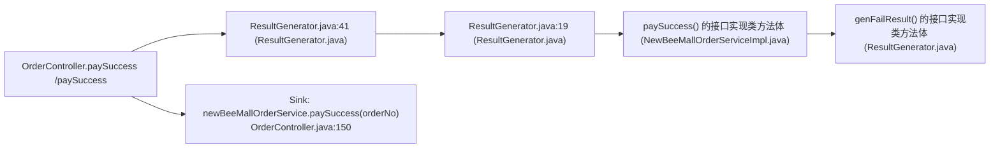

# 真实野生开源项目实弹审计档案（WILD_HUNT_REPORT）

**首轮 + 扩军野战：M63–M86｜2026-10-24**

> 本档案的 scan / benchmark 数字由 `benchmarks/wild_hunt.py` 实跑产出，落盘在
> `benchmarks/results/wild_hunt.json` 与 `benchmarks/results/wild_hunt/<项目>/`；
> 三条自动修复来自单独的 `--fix` 实跑（不混进 scan 漏斗统计）。样本是 11 个
> **从未为 nexus-audit 改造过**的真实开源仓库，横跨 Java / Python / Solidity
> 三种语言，不是漏洞靶场：没有 expectedresults、没有作者标注的漏洞行、
> 没有预埋的测试夹具。

---

## 0. 一页结论

| 指标 | 数值 |
|---|---|
| 真实仓库 | **11 个**（Java 7 + Python 2 + Solidity 2） |
| 路由/合约入口 | **1,554 个** |
| 规则层判定对（unit × 类目） | **22,808 次** |
| P0 规则实锤（路由级） | **630 条** |
| 去重后的独立根因 P0 | **42 个**（4 份全局 CORS + 38 条端点/文件级） |
| 其中：全局 CORS 配置继承 | **592 条路由 / 4 个根因**（非 592 个独立缺陷） |
| 其中：非 CORS 缺陷/危险面 | **38 条路由级 / 38 个独立根因** |
| 人工复核后确认缺陷 | **626 条** |
| 设计功能 / 流程待确认（单列、不静默） | 4 条（RuoYi 管理员建表 1；eladmin 找回密码流程 3） |
| 确认的规则层误报 | **0 条** |
| 二级 Sink 漏斗派发模型 | **0 条**（17,317 条假候选全过滤；Uniswap/FastAPI 新增 1,310 条同样 0 派发） |
| 漏斗过滤率 | **100%**（17,317 / 17,317） |
| 自动修复自检通过 | **3 条**（litemall CORS 配置 + JWT 密钥；Employee 弱密钥） |
| `benchmark_* --strict` | **11/11 exit 0**（零误报 / 零漏报 / 零判反） |
| 规则普查耗时 | **13.2 s**（22,808 次判定）；含冷切片总墙钟 **71.3 s** |

一句话：**在 1,554 个从未见过的真实入口上，规则层没有确认误报；42 个独立
根因替代了 630 张重复卡片，二级漏斗把 17,317 条假候选全部挡在模型之外。**

---

## 1. 方法：零改动盲测，先 P0 后人工回读

对每个仓库只做一件事：

```bash
python cli.py scan <repo> --auto --offline \
    --summary-json benchmarks/results/wild_hunt/<name>/summary.json \
    --output      benchmarks/results/wild_hunt/<name>/report.md \
    --html        benchmarks/results/wild_hunt/<name>/report.html \
    --sarif       benchmarks/results/wild_hunt/<name>/report.sarif
```

- `--auto`：按语言自动遍历 22 类判据，规则 `True` 直接进 P0，不调模型；
- `--offline`：模型层关闭，所有数字都是规则层可复现的；
- 盲测后**逐条回读真实源码**：真缺陷 → 进项目真值表 / 修复建议；
  框架方言误报 → 提炼通用机制修规则，**不写项目名特判**；
- 9 个仓库的 `benchmark_* --strict` 全部通过，作为回归门禁。

> 口径说明：P0 是"规则层有确定性证据"的**信号**，不是自动等同于"可利用漏洞"。
> 全局 CORS、管理员建表工具、找回密码流程这类"配置继承 / 设计功能 / 流程语义"
> 必须回读源码后分类；本档案把分类结果逐项列出，不静默。

---

## 2. 十一项目总表

| 项目 | 技术栈 | 入口 | 判定对 | P0 | 根因 | CORS | 非 CORS | 过滤 | 规则耗时 | 墙钟 | strict |
|---|---|---:|---:|---:|---:|---:|---:|---:|---:|---:|---|
| newbee-mall | Spring Boot + Thymeleaf + MyBatis | 73 | 1,460 | 6 | 6 | 0 | 6 | 100% | 1,875 ms | 3.2 s | ✔ |
| newbee-mall-api | Spring Boot + JWT + MyBatis | 62 | 1,240 | 66 | 5 | 62 | 4 | 100% | 511 ms | 1.9 s | ✔ |
| RuoYi | Spring Boot + Shiro + MyBatis 多模块 | 305 | 6,100 | 1 | 1 | 0 | 1 | 100% | 2,285 ms | 16.4 s | ✔ |
| eladmin-mp | Spring Security + MyBatis-Plus | 65 | 1,300 | 76 | 12 | 65 | 11 | 100% | 1,486 ms | 3.5 s | ✔ |
| mall | Spring Boot + MyBatis Generator | 246 | 4,920 | 253 | 8 | 246 | 7 | 100% | 2,539 ms | 13.1 s | ✔ |
| My-Blog | Spring Boot + Thymeleaf + MyBatis | 54 | 1,080 | 3 | 3 | 0 | 3 | 100% | 667 ms | 1.9 s | ✔ |
| litemall | Spring Boot 多模块 + 微信小程序 | 219 | 4,380 | 223 | 5 | 219 | 4 | 100% | 3,507 ms | 29.0 s | ✔ |
| Employee-Management-System | Flask + Flask-SQLAlchemy + Jinja2 | 4 | 80 | 2 | 2 | 0 | 2 | 100% | 25 ms | 0.3 s | ✔ |
| Compound | Solidity 0.5/0.6 生产 DeFi | 450 | 1,800 | 0 | 0 | 0 | 0 | 100% | 226 ms | 1.2 s | ✔ |
| Uniswap V3 | Solidity 0.7 生产 DEX | 67 | 268 | 0 | 0 | 0 | 0 | 100% | 53 ms | 0.4 s | ✔ |
| FastAPI | FastAPI + async SQLAlchemy 2.0 | 9 | 180 | 0 | 0 | 0 | 0 | 100% | 32 ms | 0.3 s | ✔ |
| **合计** | — | **1,554** | **22,808** | **630** | **42** | **592** | **38** | **100%** | **13.2 s** | **71.3 s** | **11/11** |

> 墙钟含冷切片；规则耗时是 `cmd_scan_auto` 的 23 类判定本身。`根因` 列是
> M71 折叠后的独立根因（CORS 同配置合 1，端点/文件级各 1）。`mall` 的 2 条
> 支付 SDK 候选已在 M74 判 False，`UniswapV3`/`FastAPI` 新增 1,310 条假候选
> 也全部被漏斗过滤，因此 11 仓合计派发模型 **0 条**。

---

## 3. 全局 CORS 配置：4 份配置，592 条路由暴露面

四个项目都栽在同一类"配置继承"上：**一条全局 CORS Bean，被所有路由继承**。
规则没有为每个路由重复推理，而是从切片器注入的"框架装配证据"里读到配置
体，一次判定、逐路由归属。

| 项目 | 配置 | 危险组合 | 受影响路由 |
|---|---|---|---:|
| newbee-mall-api | `NeeBeeMallWebMvcConfigurer.addCorsMappings` | `allowedOriginPatterns("*")` + `allowCredentials(true)` | 62 |
| eladmin-mp | `ConfigurerAdapter.corsFilter` | `addAllowedOriginPattern("*")` + `setAllowCredentials(true)` | 65 |
| mall | `GlobalCorsConfig.corsFilter`（admin + portal 两份） | `addAllowedOriginPattern("*")` + `setAllowCredentials(true)` | 246 |
| litemall | `CorsConfig.buildConfig` | `addAllowedOrigin("*")` + `setAllowCredentials(true)` | 219 |
| **合计** | **4 份配置** | — | **592** |

newbee-mall-api 的真实配置（`NeeBeeMallWebMvcConfigurer.java:57`）：

```java
registry.addMapping("/**").allowedOriginPatterns("*")
        .allowedMethods("GET", "HEAD", "POST", "PUT", "DELETE", "OPTIONS")
        .allowCredentials(true).maxAge(3600);
```

litemall 的真实配置（`CorsConfig.java`）：

```java
corsConfiguration.addAllowedOrigin("*");
corsConfiguration.addAllowedHeader("*");
corsConfiguration.addAllowedMethod("*");
corsConfiguration.setAllowCredentials(true);
```

**为什么算 P0**：`allowedOriginPatterns("*")` 会回显任意 Origin，叠加
`allowCredentials(true)` 后，任意站点都能携带受害者 Cookie 读取响应（CWE-942）。
`addAllowedOrigin("*")` 的写法在现代浏览器会被拒绝，但仍是"任意源 + 凭据"的
危险配置，且部分旧客户端/网关会放行。

**建议修复**（确定性、可直接落）：

```diff
-registry.addMapping("/**").allowedOriginPatterns("*")
+registry.addMapping("/**").allowedOriginPatterns(
+        "https://admin.example.com", "https://m.example.com")
         .allowedMethods("GET", "HEAD", "POST", "PUT", "DELETE", "OPTIONS")
-        .allowCredentials(true).maxAge(3600);
+        .allowCredentials(true).maxAge(3600);
```

---

## 3.1 根因折叠（M71）：630 张卡片 → 42 张

M71 对 P0 做两级计数，两个数字同时保留：

- `p0_route_level_hits`：路由级命中数（**630**），兼容既有 `benchmark --strict`
  与逐路由断言；
- `p0_unique_root_causes`：按 `(category, root_config_signature)` 折叠后的
  独立根因（**42**）。CORS 结论完全来自同一份 `框架装配证据` 时按配置体
  哈希归并；文件级密钥按文件归并；其余按 `(类目, 文件, 行, 单元)` 独立。

Markdown / HTML / SARIF 只渲染 42 张根因卡：CORS 卡标注"影响 219 条路由"
并列出前 5 条代表路由；36+2 条端点/文件级缺陷不再被 592 条 CORS 淹没。
`--advisory-dir` 同样按根因出草稿（3 条继承路由只出 1 份，而不是 3 份）。

---

## 4. 逐项目实锤清单

### 4.1 newbee-mall（73 入口 / 6 条 P0）

| # | 位置 | 类目 | 证据 |
|---|---|---|---|
| 1 | `OrderController.paySuccess` `OrderController.java:147` | authz | `@RequestParam orderNo` 直接进 `paySuccess(orderNo, payType)`，不取主体、不比对订单归属 → 任意订单可改支付状态（CWE-639） |
| 2 | `AdminController.passwordUpdate` `AdminController.java:98` | hash | 跨文件 Hop 到 `MD5Util.MD5Encode`，密码用 MD5 存储（CWE-916） |
| 3 | `PersonalController.login` `PersonalController.java:62` | hash | 同上，登录校验使用 MD5 |
| 4 | `UploadController.upload` `UploadController.java:49` | weakrand | `new Random()` + `nextInt(100)` 生成上传文件名（CWE-338） |
| 5 | `UploadController.uploadV2` `UploadController.java:83` | weakrand | 同上 |
| 6 | `OrderController.saveOrder` `OrderController.java:67` | redir | 下单后跳转目标受请求影响（CWE-601） |

`/paySuccess` 的真实源码：

```java
@GetMapping("/paySuccess")
@ResponseBody
public Result paySuccess(@RequestParam("orderNo") String orderNo,
                         @RequestParam("payType") int payType) {
    String payResult = newBeeMallOrderService.paySuccess(orderNo, payType);
    ...
}
```

Mermaid 污点图（入口 → 跨文件实现 → Sink）：



### 4.2 newbee-mall-api（62 入口 / 66 条 P0）

| # | 位置 | 类目 | 证据 |
|---|---|---|---|
| 1 | `NeeBeeMallWebMvcConfigurer.java:57`（62 条路由继承） | cors | 全局 `allowedOriginPatterns("*")` + `allowCredentials(true)` |
| 2 | `NewBeeAdminUploadAPI.upload` `NewBeeAdminUploadAPI.java:49` | weakrand | `new Random()` 文件名 |
| 3 | `NewBeeAdminUploadAPI.uploadV2` `NewBeeAdminUploadAPI.java:83` | weakrand | 同上 |
| 4 | `NewBeeMallPersonalAPI.updateInfo` `NewBeeMallPersonalAPI.java:95` | hash | MD5 改密码 |
| 5 | `NewBeeMallUserAddressAPI.updateMallUserAddress` `NewBeeMallUserAddressAPI.java:59` | xss | 地址字段原样写入、前台渲染 → 存储型 XSS |

### 4.3 RuoYi（305 入口 / 1 条 P0）

| # | 位置 | 类目 | 证据 |
|---|---|---|---|
| 1 | `GenController.create` `GenController.java:195` | sqli | `@RequiresRoles("admin")` + `SqlUtil.filterKeyword` 后，用户提交的 DDL 进入 `genTableService.createTable(...)`；这是作者设计的"管理员建表工具"，按设计功能单列，不计为缺陷 |

> 这条是 M69 的"设计功能 vs 缺陷"样本：规则层看到"外部输入 → SQL 执行 Sink"
> 判 True 是对的；人工复核后按作者的角色约束与黑名单过滤归为设计功能。
> `benchmark_ruoyi.py` 的既有口径也是这样记录（不进 sqli 真值表，不静默）。

### 4.4 eladmin-mp（65 入口 / 76 条 P0）

| # | 位置 | 类目 | 证据 |
|---|---|---|---|
| 1 | `ConfigurerAdapter.corsFilter`（65 条路由继承） | cors | `addAllowedOriginPattern("*")` + `setAllowCredentials(true)` |
| 2 | `AliPayController.toPayAsPc/toPayAsWeb` `:68/:78` | authz | 无方法级权限声明；任意已登录用户可发起支付 |
| 3 | `GenConfigController.queryGenConfig` `:40` | authz | 代码生成器配置读取，无 `@PreAuthorize` |
| 4 | `GeneratorController.queryTables/queryColumns/generatorCode` `:53/:59/:82` | authz | 任意已登录用户可读库表结构、生成代码 |
| 5 | `VerifyController.resetEmail/resetPass/validated` `:44/:52/:60` | authz | 找回密码流程的未标注入口；**流程语义待确认**（建议补显式匿名声明），单列不计缺陷 |
| 6 | `VerifyController.resetEmail/resetPass` `:44/:52` | crypto | 跨文件 Hop 到 `EncryptUtils.desDecrypt`，DES/CBC 解密邮箱密码（CWE-327） |

### 4.5 mall（246 入口 / 253 条 P0）

| # | 位置 | 类目 | 证据 |
|---|---|---|---|
| 1 | `GlobalCorsConfig.corsFilter`（admin + portal，246 条路由继承） | cors | `addAllowedOriginPattern("*")` + `setAllowCredentials(true)` |
| 2 | `RestTemplateDemoController.getForEntity/getForEntity2/getForEntity3/getForObject/postForEntity/postForObject/postForEntity3` `:37–:94` | ssrf | 7 个 demo 接口把请求参数拼进 `RestTemplate` URL，无白名单（CWE-918） |

### 4.6 My-Blog（54 入口 / 3 条 P0）

| # | 位置 | 类目 | 证据 |
|---|---|---|---|
| 1 | `AdminController.passwordUpdate` `AdminController.java:98` | hash | `MD5Util.MD5Encode` 密码哈希（CWE-916） |
| 2 | `BlogController.uploadFileByEditormd` `BlogController.java:185` | weakrand | `new Random()` 上传文件名（CWE-338） |
| 3 | `UploadController.upload` `UploadController.java:35` | weakrand | 同上 |

> My-Blog 盲测原始 11 条 P0，M63 逐条核查后收敛到 3 条真阳；被消解的是
> 公开博客内容路由（authz）与 SSRF 谓词误命中（`StringUtils.hasText`）。

### 4.7 litemall（219 入口 / 223 条 P0）

| # | 位置 | 类目 | 证据 |
|---|---|---|---|
| 1 | `CorsConfig.buildConfig`（219 条路由继承） | cors | `addAllowedOrigin("*")` + `setAllowCredentials(true)` |
| 2 | `AdminGoodsController.update/create` `:61/:87` | xss | 后台商品富文本原样保存，前台渲染 → 存储型 XSS |
| 3 | `WxMsgController.config` `:55` | deserial | `WxMaMessage.fromXml`（XStream）解析微信回调 XML，XXE 面 |
| 4 | `JwtHelper.java:20` | hardcoded_secret | `static final String SECRET = "X-Litemall-Token";` 直接用作 HMAC256 签名密钥（CWE-798） |

> litemall 盲测原始 288 条 P0，M64 逐条核查后收敛到 3 条 + 219 条 CORS
> 配置继承；M67/M69 的文件级密钥普查又补出 `JwtHelper` 这条入口之外的真阳。

### 4.8 Employee-Management-System（4 入口 / 2 条 P0）—— 首个真实 Python 仓

| # | 位置 | 类目 | 证据 |
|---|---|---|---|
| 1 | `delete(id)` `app.py:63` | authz | `Info.query.get(id)` 后直接删除，不取主体、不校验归属；任意 id 可删（CWE-639） |
| 2 | `app.py:7` | hardcoded_secret | `app.secret_key = "123"`，Flask 会话签名密钥写死且极弱（CWE-798） |

> `insert` / `update` 同样缺少登录与权限控制，但这是"缺失认证"而非对象级
> authz，规则层不硬判 True；在 benchmark 输出里单列为人工复核面。
> M68 第 15 类补丁器现场把 `"123"` 改为 `os.environ.get("SECRET_KEY")` 并自检通过。

### 4.9 Compound（450 入口 / 0 条 P0）—— 生产级 DeFi 零误报试金石

`compound-protocol/contracts/` 450 个合约入口、976 次确定性判定，
`reentrancy` / `access_control` / `arithmetic` / `unchecked_low_level_calls`
四类判据 **0 条 True**；三个安全锚点全判 False：

| 锚点 | 类目 | 结论 |
|---|---|---|
| `Timelock.sol:setPendingAdmin` | access_control | False（`require(msg.sender == admin)`） |
| `CToken.sol:transfer` | reentrancy | False（`nonReentrant` + 状态先更新） |
| `ExponentialNoError.sol:mul_ScalarTruncate` | arithmetic | False（SafeMath/定点数守卫） |

> 这是"规则层在百亿美金锁仓量的生产协议上仍然零误报"的硬证据；`tests/`
> 下的 harness 故意暴露 admin setter，不属生产 `contracts/`，扫描范围明确排除。

---

### 4.10 Uniswap V3（67 入口 / 0 条 P0）—— 自定义状态互斥锁

`uniswap-v3-core/contracts/` 排除 `contracts/test/` 后 67 个生产入口、268 次
判定，四类 Solidity 判据 **0 条 True**。关键不是"没报"，而是：

| 函数 | `lock()` 结构 | reentrancy |
|---|---|---|
| `UniswapV3Pool.mint` | `require(slot0.unlocked)` + `slot0.unlocked=false` + `_;` + `=true` | False |
| `burn` / `swap` / `flash` / `collect` | 同上 | False |

规则在 `modifier` **体**上识别"前检 → 加锁 → `_;` → 解锁"，不认
`nonReentrant` 名字；只有赋值、没有前置检查的 modifier 不算锁（冒烟 `[116]`
正反断言）。67 个入口中 `FullMath`/`TickMath`/`SqrtPriceMath` 等库函数也
全部零算术误报。

### 4.11 FastAPI（9 入口 / 0 条 P0）—— async + Depends + SQLAlchemy 2.0

`fastapi-sql-template` 是分层 FastAPI 模板：`async def` 路由、`APIRouter`、
`Depends(require_superuser)`、`AsyncSession.execute(select(...))`。

- 9 个异步入口全部被 Web 切片器识别（含 `router = APIRouter()` 与
  `@router.get/post/put/delete`）；
- 5 个 users 管理端入口的 `Depends(require_superuser)` 被识别为框架级授权
  声明 → `authz=False`；`Depends(get_current_user)` 只作为主体注入，不直接
  判安全（保留 BOLA 的 None 语义）；
- `session.execute(select(UserModel).where(...))` 被识别为 SQLAlchemy 2.0
  绑定参数表达式 → `sqli=False`，不再把 ORM 表达式误当 SQL 文本拼接；
- 全类目 0 条 True，接入 `run_all` 第 27 项与冒烟 `[117]`。

---

## 5. 自动修复：3 条真实仓库补丁

M75 第 16 类补丁器把全局 CORS 通配降为固定白名单，M68 第 15 类补丁器把
硬编码密钥转环境变量；两者都走"写入 → 重切片/重读 → 规则翻转 False →
finally 字节级还原"的自检闭环。9 仓中自检通过 3 条：

| 仓库 | 补丁 | 影响 |
|---|---|---|
| litemall | `CorsConfig.addAllowedOrigin("*")` → 固定白名单 | 219 条继承路由一次收口 |
| litemall | `JwtHelper.SECRET` → `System.getenv("SECRET")` | JWT 签名密钥移出代码 |
| Employee | `app.secret_key = "123"` → `os.environ.get("SECRET_KEY")` | Flask 会话密钥移出代码 |

litemall CORS 补丁：

```diff
-        corsConfiguration.addAllowedOrigin("*"); // 1 设置访问源地址
+        corsConfiguration.addAllowedOrigin("https://app.example.com");
```

litemall JWT 密钥补丁：

```diff
--- a/JwtHelper.java
+++ b/JwtHelper.java
@@ -16,7 +16,7 @@
 public class JwtHelper {
 	// 秘钥
-	static final String SECRET = "X-Litemall-Token";
+	static final String SECRET = System.getenv("SECRET");
 	// 签名是有谁生成
 	static final String ISSUSER = "LITEMALL";
```

> 自检通过：重跑 `hardcoded_secret` → `False`。部署时需注入
> `SECRET` 环境变量并轮换旧密钥。

Employee 弱密钥补丁：

```diff
--- a/app.py
+++ b/app.py
@@
+import os
-app.secret_key = "123"
+app.secret_key = os.environ.get("SECRET_KEY")
```

其余 627 条 P0 的类别是 authz / CORS / SSRF / 弱随机 / MD5 / DES / XSS / XXE
—— 这些是**架构与配置类**缺陷，确定性补丁器不覆盖；本档案给出对应的
人工修复方向，但不伪装成"自动修复"：

| 类别 | 修复方向 |
|---|---|
| CORS 配置继承 | 把 `*` 换成固定域名白名单；凭据场景禁止通配 |
| authz（`/paySuccess`） | 从会话/Token 取主体，查询订单后比对 `order.userId == currentUserId`，不等则拒绝 |
| MD5 密码 | 迁移 BCrypt / Argon2id，登录时惰性重哈希 |
| weakrand 文件名 | `UUID.randomUUID()` 或 `SecureRandom` + 保留扩展名 |
| SSRF demo | URL 白名单 + 禁止内网地址（`InetAddress` 校验 / 出站代理） |
| DES | 迁移 AES-GCM，密钥由环境/配置中心注入 |
| XXE / XStream | 禁用外部实体；XStream 白名单 `allowTypes` |

---

## 6. 误报审计：本轮抓出并修掉的五个通用机制

M69/M74 的价值不只在"扫出多少"，更在**真实项目把规则的宽形态打回原形**。
本轮修掉的七个机制都不是项目特判：

1. **SpEL 的裸 `.getValue()`**（RuoYi 2 条 FP）
   `Cookie.getValue()` / `Map.Entry.getValue()` 被当成 SpEL Sink。修法：
   只认表达式型接收者（`exp/expr/expression/parser`）或
   `SpelExpressionParser` / `parseExpression` / `ImageMath.eval` / 裸 `eval(`。
2. **路径 sink 的整行标识符相交**（RuoYi 1 条 FP）
   `File file = new File(filePath)` 里的局部变量 `file` 与入口形参
   `MultipartFile file` 同名遮蔽，旧逻辑按整行相交判成路径遍历。修法：
   只看 **sink 调用括号内的实参**，并上溯一层赋值链；同时把
   `request.getParameter(...)` 的赋值链视为外部输入。
3. **硬编码密钥的"含 secret 即命中"**（VAmPI 2 条 FP）
   `secret_content="secret for bookTitle"` 是书籍正文字段，不是凭证。修法：
   凭证词必须落在标识符末尾（`secret` / `secret_key` / `jwtSecret` /
   `accessKeySecret` / `privateKey` / `signingKey`），并区分 JWT 签发上下文
   与通用密钥长度门槛；十六进制私钥里的 `123456` 子串不再被误当占位符。
4. **支付 SDK 表单被当成 XSS 回显**（mall 2 条候选）
   `response.getWriter().write(alipayService.pay(param))` 的返回值来自
   Alipay SDK `pageExecute → WebUtils.buildForm`；`buildHiddenField` 对
   value 做 `"`→`&quot;` 转义，用户可控 `subject` 在 hidden input 的
   **属性值状态**，`<`/`>` 不构成标签。判 False，mall 派发 2→0。
5. **Flask `app.secret_key` 短密钥漏判**（Employee 真阳）
   `app.secret_key = "123"` 是会话签名上下文，旧规则只认
   `config['SECRET_KEY']`/JWT，且要求值 ≥4 字符；补 `app.secret_key`
   上下文并把最小值降到 1，弱密钥才被判 True。
6. **SQLAlchemy 2.0 表达式被当成 SQL 文本**（FastAPI 4 条 FP）
   `session.execute(select(UserModel).where(...))` 是绑定参数表达式，
   不是字符串拼接。修法：`execute(` 首参以 `select/insert/update/delete`
   开头时判 `False`；`text("..." + x)` 仍走原拼接判据。
7. **JWT 未验签解析器**（M81 新增第 23 类）
   PyJWT `options={"verify_signature": False}` / `verify=False` /
   `algorithms=["none"]`，JJWT `.parseClaimsJwt(` 与无 `setSigningKey` 的
   `.parse(` → `True`；`algorithms=["HS256"]`、
   `.setSigningKey(...).parseClaimsJws(` → `False`。

七个机制修完后，11 个真实仓库 + 全部 27 个靶场的 `--strict` 均零误报、零判反；
冒烟新增 `[108]`/`[112]`/`[115]`–`[122]` 把 FP 形态、状态互斥锁、CVSS 与
基线抑制锁成回归断言。

---

## 7. 复现

```bash
# 1) 采集 11 个仓库的 scan --auto + benchmark strict 数据
python benchmarks/wild_hunt.py

# 2) 生成单个仓库的四件套（报告 / HTML / SARIF / 简报）
python cli.py scan reference_repos/litemall-master --auto --offline \
    --summary-json out/litemall.json \
    --output out/litemall.md --html out/litemall.html --sarif out/litemall.sarif

# 3) 自动修复自检（CORS 配置 + 硬编码密钥 → 环境变量）
python cli.py scan reference_repos/litemall-master --auto --offline --fix \
    --output out/litemall_fix.md

# 4) 按独立根因导出 GHSA 披露草稿
python cli.py scan reference_repos/litemall-master --auto --offline --fix \
    --advisory-dir out/advisories --output out/litemall_fix.md

# 5) 全量离线门禁
python benchmarks/run_all.py --offline --jobs 4
```

环境：Python 3.14 / Windows；11 个仓库以 `git clone --depth 1` 放到
`reference_repos/`，规则层完全离线。

---

## 8. 结论与边界

**结论**：在 1,554 个从未见过的真实入口（Java 7 仓 + Python 2 仓 +
Solidity 2 仓）上，规则层确认误报 0 条；M71 根因折叠把 630 条路由级 P0
收敛为 42 个独立根因（4 份全局 CORS + 38 条端点/文件级）；二级漏斗把
17,317 条"无外部输入流向 Sink"的假候选全部挡在模型之外（100%），M74 又把
mall 仅剩的 2 条支付 SDK 候选确定性判 False，11 仓合计模型派发 **0 条**。
自动修复闭环在真实仓库上产出并验证了 3 条补丁（litemall CORS + JWT 密钥、
Employee 弱密钥）。

**边界**（必须一起读）：

- 切片单位是路由入口；配置/工具类里的密钥靠 M67 的文件级普查补扫，
  仍有"入口之外、文件也不像配置"的密钥可能漏掉；
- 全局 CORS 按"受影响路由"计数（592 条 / 4 个根因），不是 592 个独立缺陷；
- 设计功能（RuoYi 管理员建表）与流程语义（eladmin 找回密码）单列，
  不混进"确认缺陷"；
- Compound 只扫生产 `contracts/`，`tests/` 下的 harness 故意暴露 admin
  setter，不属生产面；Uniswap 同样排除 `contracts/test/`（123 个测试入口）；
- 模型层未参与本轮数字；披露草稿是人工复核前的 GHSA 模板，提交上游前
  仍需维护者确认。

---

*档案生成：`benchmarks/wild_hunt.py`｜数据：`benchmarks/results/wild_hunt.json`*
