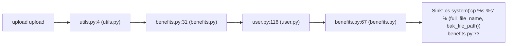

# CWE-78 · cmdi in views.py

**GHSA-07E3-44FB-F343** ｜ 规则层 P0 ｜ endpoint
**CVSS v3.1：9.8 CRITICAL** ｜ `CVSS:3.1/AV:N/AC:L/PR:N/UI:N/S:U/C:H/I:H/A:H`

## Affected Component

- Repository: `C:\myFloders\git\nexus-audit\reference_repos\DjanGoat`
- File: `app/views/users/benefit_forms/views.py:40`
- Representative entry: `upload`
- Affected routes: **1**（同一独立根因）

- `upload`

## Vulnerability Mechanism

类目 `cmdi`（CWE-78）。根因签名：`cmdi:C:\myFloders\git\nexus-audit\reference_repos\DjanGoat\app\views\users\benefit_forms\views.py:40:upload`。

- `global-config`：结论来自 `框架装配证据` 中的同一份全局配置，所有
  受影响路由共享该根因；修一处配置即消解整组告警。
- `file-level`：密钥/凭证直接写在配置文件或工具类中。
- `endpoint`：入口方法自身的确定性证据，按文件/行独立。

## Taint Flow



## PoC Harness

```python
"""upload 的 PoC 骨架（M45 PoC 合成器）。

规则层判定：cmdi = True
目标位置：views.py:40
运行：pytest test_poc_upload.py -q
"""
import pytest


@pytest.fixture
def client():
    """离线占位：真实环境应替换成 app.test_client() 或 requests.Session。"""
    raise NotImplementedError("请在此接入被测应用的测试客户端")


ATTACKER = "attacker"
VICTIM = "victim"


def test_bola_other_account_denied(client):
    """用他人身份访问本账户资源应被拒绝 —— 放行即越权。"""
    resp = client.get("upload", params={"request": "1"}, headers={"Authorization": "Bearer " + ATTACKER})
    assert resp.status_code in (401, 403, 404), (
        "越权访问未被拒绝（状态码 %s）" % resp.status_code)

```

> 自检：ast.parse 通过

## Verified Patch

（本次未跑 `--fix` 或该类目没有确定性补丁器；架构/配置类缺陷按建议手工修复。）

## References

- CWE: https://cwe.mitre.org/data/definitions/78.html
- Generated by nexus-audit `scan --auto --advisory-dir`
