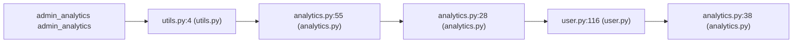

# CWE-89 · sqli in views.py 

**GHSA-9C20-B47A-4772** ｜ 规则层 P0 ｜ endpoint
**CVSS v3.1：9.8 CRITICAL** ｜ `CVSS:3.1/AV:N/AC:L/PR:N/UI:N/S:U/C:H/I:H/A:H`

## Affected Component

- Repository: `C:\myFloders\git\nexus-audit\reference_repos\DjanGoat`
- File: `app/views/admin/views.py:86`
- Representative entry: `admin_analytics`
- Affected routes: **1**（同一独立根因）

- `admin_analytics`

## Vulnerability Mechanism

类目 `sqli`（CWE-89）。根因签名：`sqli:C:\myFloders\git\nexus-audit\reference_repos\DjanGoat\app\views\admin\views.py:86:admin_analytics`。

- `global-config`：结论来自 `框架装配证据` 中的同一份全局配置，所有
  受影响路由共享该根因；修一处配置即消解整组告警。
- `file-level`：密钥/凭证直接写在配置文件或工具类中。
- `endpoint`：入口方法自身的确定性证据，按文件/行独立。

## Taint Flow



## PoC Harness

```python
"""admin_analytics 的 PoC 骨架（M45 PoC 合成器）。

规则层判定：sqli = True
目标位置：views.py:86
运行：pytest test_poc_admin_analytics.py -q
"""
import pytest


@pytest.fixture
def client():
    """离线占位：真实环境应替换成 app.test_client() 或 requests.Session。"""
    raise NotImplementedError("请在此接入被测应用的测试客户端")


ATTACKER = "attacker"
VICTIM = "victim"


def test_sqli_payload_reaches_backend(client):
    """注入载荷应被参数化查询挡住 —— 若后端报 SQL 语法错误即存在注入。"""
    payload = "' OR '1'='1' --"
    resp = client.get("admin_analytics", params={"request": "1"})
    assert resp.status_code not in (500,), (
        "SQL 注入载荷触发了服务端错误，疑似未参数化：%s" % payload)

```

> 自检：ast.parse 通过

## Verified Patch

（本次未跑 `--fix` 或该类目没有确定性补丁器；架构/配置类缺陷按建议手工修复。）

## Quick Reproduction Command

```bash
# 1) 离线复核本仓（本根因在输出里按 app/views/admin/views.py:86 定位）
python cli.py scan C:\myFloders\git\nexus-audit\reference_repos\DjanGoat --auto --offline

# 2) 生成 PoC + 自检补丁 + 披露包
python cli.py scan C:\myFloders\git\nexus-audit\reference_repos\DjanGoat --auto --offline --emit-poc poc/ --fix --advisory-dir adv/

# 3) 只看本类目（24 类中的 sqli）
python cli.py scan C:\myFloders\git\nexus-audit\reference_repos\DjanGoat --categories sqli --offline
```

## References

- CWE: https://cwe.mitre.org/data/definitions/89.html
- Generated by nexus-audit `scan --auto --advisory-dir`
