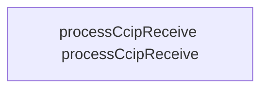

# CWE-000 · unchecked_low_level_calls in CrossChain.sol 

**GHSA-0F31-56EF-6B33** ｜ 规则层 P0 ｜ endpoint
**CVSS v3.1：8.1 HIGH** ｜ `CVSS:3.1/AV:N/AC:L/PR:L/UI:N/S:U/C:H/I:H/A:N`

## Affected Component

- Repository: `C:\myFloders\git\nexus-audit\reference_repos\synthetix-v3`
- File: `utils/core-modules/contracts/storage/CrossChain.sol:50`
- Representative entry: `processCcipReceive`
- Affected routes: **1**（同一独立根因）

- `processCcipReceive`

## Vulnerability Mechanism

类目 `unchecked_low_level_calls`（CWE-000）。根因签名：`unchecked_low_level_calls:C:\myFloders\git\nexus-audit\reference_repos\synthetix-v3\utils\core-modules\contracts\storage\CrossChain.sol:50:processCcipReceive`。

- `global-config`：结论来自 `框架装配证据` 中的同一份全局配置，所有
  受影响路由共享该根因；修一处配置即消解整组告警。
- `file-level`：密钥/凭证直接写在配置文件或工具类中。
- `endpoint`：入口方法自身的确定性证据，按文件/行独立。

## Taint Flow



## PoC Harness

```solidity
// SPDX-License-Identifier: MIT
// 自动生成的 PoC 骨架（M45 PoC 合成器）—— 目标：processCcipReceive
// 规则层判定：unchecked_low_level_calls = True
// 目标位置：CrossChain.sol:50
pragma solidity ^0.8.0;

import "forge-std/Test.sol";

contract RevertReceiver {
    // 拒收 ETH 的合约（无 receive/payable fallback）
    // → 目标合约的低层调用静默失败，状态照常推进（SWC-104）
}

contract PocprocessCcipReceive is Test {
    function testExploit() public {
        Victim victim = new Victim();
        RevertReceiver receiver = new RevertReceiver();

        vm.deal(address(victim), 1 ether);
        uint256 receiverBalanceBefore = address(receiver).balance;

        // 目标合约向拒收地址发起底层调用 —— 返回值被丢弃，
        // 失败被静默吞掉，合约状态与预期不一致
        // （骨架按 Victim.withdraw(address) 形态生成；实际接入时
        //  按目标函数签名替换 encodeWithSignature 的内容）
        (bool ok, ) = address(victim).call(
            abi.encodeWithSignature("withdraw(address)", address(receiver)));
        ok; // 老语法双返回值占位

        // 断言：调用失败（资金未到账）—— 失败静默就是漏洞本身；
        // 修复版会 require(ok) 让整笔回滚
        assertTrue(address(receiver).balance == receiverBalanceBefore,
                   "receiver must not accept ETH");
    }
}

```

> 自检：括号配平 + contract/test/pragma 齐备

## Verified Patch

（本次未跑 `--fix` 或该类目没有确定性补丁器；架构/配置类缺陷按建议手工修复。）

## Quick Reproduction Command

```bash
# 1) 离线复核本仓（本根因在输出里按 utils/core-modules/contracts/storage/CrossChain.sol:50 定位）
python cli.py scan C:\myFloders\git\nexus-audit\reference_repos\synthetix-v3 --auto --offline

# 2) 生成 PoC + 自检补丁 + 披露包
python cli.py scan C:\myFloders\git\nexus-audit\reference_repos\synthetix-v3 --auto --offline --emit-poc poc/ --fix --advisory-dir adv/

# 3) 只看本类目（24 类中的 unchecked_low_level_calls）
python cli.py scan C:\myFloders\git\nexus-audit\reference_repos\synthetix-v3 --categories unchecked_low_level_calls --offline
```

## References

- CWE: https://cwe.mitre.org/data/definitions/000.html
- Generated by nexus-audit `scan --auto --advisory-dir`
