# CWE-79 · xss in ConsumerController.java 

**GHSA-0E50-DD3E-643E** ｜ 规则层 P0 ｜ endpoint
**CVSS v3.1：6.1 MEDIUM** ｜ `CVSS:3.1/AV:N/AC:L/PR:N/UI:R/S:C/C:L/I:L/A:N`

## Affected Component

- Repository: `C:\myFloders\git\nexus-audit\reference_repos\apollo`
- File: `apollo-portal/src/main/java/com/ctrip/framework/apollo/portal/controller/ConsumerController.java:73`
- Representative entry: `ConsumerController.create`
- Affected routes: **1**（同一独立根因）

- `ConsumerController.create`

## Vulnerability Mechanism

类目 `xss`（CWE-79）。根因签名：`xss:C:\myFloders\git\nexus-audit\reference_repos\apollo\apollo-portal\src\main\java\com\ctrip\framework\apollo\portal\controller\ConsumerController.java:73:ConsumerController.create`。

- `global-config`：结论来自 `框架装配证据` 中的同一份全局配置，所有
  受影响路由共享该根因；修一处配置即消解整组告警。
- `file-level`：密钥/凭证直接写在配置文件或工具类中。
- `endpoint`：入口方法自身的确定性证据，按文件/行独立。

## Taint Flow

```mermaid
flowchart LR
  N0["ConsumerController.create /consumers"]
  N1["同文件辅助方法 (ConsumerController.java)"]
  N2["ConsumerService.java:290 (ConsumerService.java)"]
  N3["ConsumerService.java:294 (ConsumerService.java)"]
  N4["ConsumerService.java:120 (ConsumerService.java)"]
  N5["AccessKeyController.java:55 (AccessKeyController.java)"]
  N6["AccessKeyService.java:42 (AccessKeyService.java)"]
  N7["AdminServiceAPI.java:291 (AdminServiceAPI.java)"]
  N8["UniqueKeyGenerator.java:62 (UniqueKeyGenerator.java)"]
  N9["BadRequestException.java:109 (BadRequestException.java)"]
  N10["跨文件证据：被调方法的接口声明（方法无方法体，实现由框架/子类提供） (ConsumerController.java)"]
  N11["createConsumer() 的接口实现类方法体 (ConsumerService.java)"]
  N12["generateAndSaveConsumerToken() 的接口实现类方法体 (ConsumerService.java)"]
  N13["assignCreateApplicationRoleToConsumer() 的接口实现类方法体 (ConsumerService.java)"]
  N15["跨路由串接证据 (ConsumerController.java)"]
  N0 --> N1
  N1 --> N2
  N2 --> N3
  N3 --> N4
  N4 --> N5
  N5 --> N6
  N6 --> N7
  N7 --> N8
  N8 --> N9
  N9 --> N10
  N10 --> N11
  N11 --> N12
  N12 --> N13
  N13 --> N15
```



## PoC Harness

```java
// 自动生成的 PoC 骨架（M45 PoC 合成器）
// 规则层判定：xss = True
// 目标位置：ConsumerController.java:73
package poc;

import org.junit.jupiter.api.Test;
import org.springframework.beans.factory.annotation.Autowired;
import org.springframework.boot.test.autoconfigure.web.servlet.AutoConfigureMockMvc;
import org.springframework.boot.test.context.SpringBootTest;
import org.springframework.test.web.servlet.MockMvc;
import static org.springframework.test.web.servlet.request.MockMvcRequestBuilders.*;
import static org.springframework.test.web.servlet.result.MockMvcResultMatchers.*;
import static org.springframework.test.web.servlet.setup.MockMvcBuilders.*;
import static org.hamcrest.Matchers.not;

@SpringBootTest
@AutoConfigureMockMvc
public class Consumercontroller_createPocTest {

    @Autowired
    private MockMvc mockMvc;

    @Test
    void otherAccountResourceDenied() throws Exception {
        mockMvc.perform(get("/consumers").param("id", "9999")
                .header("Authorization", "Bearer attacker-token"))
            .andExpect(status().is4xxClientError());
    }
}

```

> 自检：括号配平 + class/@Test/import 齐备

## Verified Patch

（本次未跑 `--fix` 或该类目没有确定性补丁器；架构/配置类缺陷按建议手工修复。）

## Quick Reproduction Command

```bash
# 1) 离线复核本仓（本根因在输出里按 apollo-portal/src/main/java/com/ctrip/framework/apollo/portal/controller/ConsumerController.java:73 定位）
python cli.py scan C:\myFloders\git\nexus-audit\reference_repos\apollo --auto --offline

# 2) 生成 PoC + 自检补丁 + 披露包
python cli.py scan C:\myFloders\git\nexus-audit\reference_repos\apollo --auto --offline --emit-poc poc/ --fix --advisory-dir adv/

# 3) 只看本类目（24 类中的 xss）
python cli.py scan C:\myFloders\git\nexus-audit\reference_repos\apollo --categories xss --offline
```

## References

- CWE: https://cwe.mitre.org/data/definitions/79.html
- Generated by nexus-audit `scan --auto --advisory-dir`
