# CWE-89 · sqli in AccessKeyController.java 

**GHSA-D393-547B-EB92** ｜ 规则层 P0 ｜ endpoint
**CVSS v3.1：9.8 CRITICAL** ｜ `CVSS:3.1/AV:N/AC:L/PR:N/UI:N/S:U/C:H/I:H/A:H`

## Affected Component

- Repository: `C:\myFloders\git\nexus-audit\reference_repos\apollo`
- File: `apollo-adminservice/src/main/java/com/ctrip/framework/apollo/adminservice/controller/AccessKeyController.java:65`
- Representative entry: `AccessKeyController.enable`
- Affected routes: **1**（同一独立根因）

- `AccessKeyController.enable`

## Vulnerability Mechanism

类目 `sqli`（CWE-89）。根因签名：`sqli:C:\myFloders\git\nexus-audit\reference_repos\apollo\apollo-adminservice\src\main\java\com\ctrip\framework\apollo\adminservice\controller\AccessKeyController.java:65:AccessKeyController.enable`。

- `global-config`：结论来自 `框架装配证据` 中的同一份全局配置，所有
  受影响路由共享该根因；修一处配置即消解整组告警。
- `file-level`：密钥/凭证直接写在配置文件或工具类中。
- `endpoint`：入口方法自身的确定性证据，按文件/行独立。

## Taint Flow

```mermaid
flowchart LR
  N0["AccessKeyController.enable /apps/&lbrace;appId&rbrace;/accesskeys/&lbrace;id&rbrace;/enable"]
  N1["AppController.java:141 (AppController.java)"]
  N2["DefaultUserInfoHolder.java:33 (DefaultUserInfoHolder.java)"]
  N3["ReleaseController.java:336 (ReleaseController.java)"]
  N4["ConfigPublishEvent.java:32 (ConfigPublishEvent.java)"]
  N5["ConfigPublishEvent.java:71 (ConfigPublishEvent.java)"]
  N6["ConfigPublishEvent.java:66 (ConfigPublishEvent.java)"]
  N7["ConfigPublishEvent.java:41 (ConfigPublishEvent.java)"]
  N8["AppService.java:215 (AppService.java)"]
  N9["AccessKeyController.java:55 (AccessKeyController.java)"]
  N10["AccessKeyService.java:42 (AccessKeyService.java)"]
  N11["setId() 的接口实现类方法体 (ReleaseHistoryBO.java)"]
  N12["setMode() 的接口实现类方法体 (ApolloSqlInitializationProperties.java)"]
  N13["setEnabled() 的接口实现类方法体 (UserInfo.java)"]
  N15["跨路由串接证据 (AccessKeyController.java)"]
  N0 --> N1
  N1 --> N2
  N2 --> N3
  N3 --> N4
  N4 --> N5
  N5 --> N6
  N6 --> N7
  N7 --> N8
  N8 --> N9
  N9 --> N10
  N10 --> N11
  N11 --> N12
  N12 --> N13
  N13 --> N15
  SINK["Sink: spring.security.oauth2.client.provider.keycloak.issuer-uri =<br/>AccessKeyController.java:78"]
  N0 --> SINK
```



## PoC Harness

```java
// 自动生成的 PoC 骨架（M45 PoC 合成器）
// 规则层判定：sqli = True
// 目标位置：AccessKeyController.java:65
package poc;

import org.junit.jupiter.api.Test;
import org.springframework.beans.factory.annotation.Autowired;
import org.springframework.boot.test.autoconfigure.web.servlet.AutoConfigureMockMvc;
import org.springframework.boot.test.context.SpringBootTest;
import org.springframework.test.web.servlet.MockMvc;
import static org.springframework.test.web.servlet.request.MockMvcRequestBuilders.*;
import static org.springframework.test.web.servlet.result.MockMvcResultMatchers.*;
import static org.springframework.test.web.servlet.setup.MockMvcBuilders.*;
import static org.hamcrest.Matchers.not;

@SpringBootTest
@AutoConfigureMockMvc
public class Accesskeycontroller_enablePocTest {

    @Autowired
    private MockMvc mockMvc;

    @Test
    void sqlInjectionPayloadRejected() throws Exception {
        mockMvc.perform(get("/apps/{appId}/accesskeys/{id}/enable").param("id", "' OR '1'='1' --"))
            .andExpect(status().is4xxClientError());
    }
}

```

> 自检：括号配平 + class/@Test/import 齐备

## Verified Patch

（本次未跑 `--fix` 或该类目没有确定性补丁器；架构/配置类缺陷按建议手工修复。）

## Quick Reproduction Command

```bash
# 1) 离线复核本仓（本根因在输出里按 apollo-adminservice/src/main/java/com/ctrip/framework/apollo/adminservice/controller/AccessKeyController.java:65 定位）
python cli.py scan C:\myFloders\git\nexus-audit\reference_repos\apollo --auto --offline

# 2) 生成 PoC + 自检补丁 + 披露包
python cli.py scan C:\myFloders\git\nexus-audit\reference_repos\apollo --auto --offline --emit-poc poc/ --fix --advisory-dir adv/

# 3) 只看本类目（24 类中的 sqli）
python cli.py scan C:\myFloders\git\nexus-audit\reference_repos\apollo --categories sqli --offline
```

## References

- CWE: https://cwe.mitre.org/data/definitions/89.html
- Generated by nexus-audit `scan --auto --advisory-dir`
