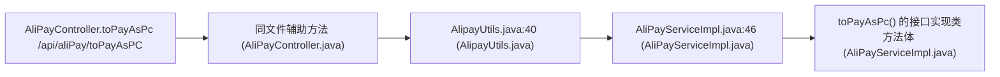

# CWE-942 · cors in AliPayController.java

**GHSA-A12F-C348-60F5** ｜ 规则层 P0 ｜ global-config
**CVSS v3.1：6.5 MEDIUM** ｜ `CVSS:3.1/AV:N/AC:L/PR:N/UI:R/S:U/C:H/I:N/A:N`

## Affected Component

- Repository: `C:\myFloders\git\nexus-audit\reference_repos\eladmin-mp-master`
- File: `eladmin/eladmin-tools/src/main/java/me/zhengjie/rest/AliPayController.java:68`
- Representative entry: `AliPayController.toPayAsPc`
- Affected routes: **65**（同一独立根因）

- `AliPayController.toPayAsPc`
- `AliPayController.toPayAsWeb`
- `AliPayController.notify`
- `LocalStorageController.exportFile`
- `LocalStorageController.uploadPicture`

## Vulnerability Mechanism

类目 `cors`（CWE-942）。根因签名：`cors:7d8d7d1f928a`。

- `global-config`：结论来自 `框架装配证据` 中的同一份全局配置，所有
  受影响路由共享该根因；修一处配置即消解整组告警。
- `file-level`：密钥/凭证直接写在配置文件或工具类中。
- `endpoint`：入口方法自身的确定性证据，按文件/行独立。

## Taint Flow



## PoC Harness

```java
// 自动生成的 PoC 骨架（M45 PoC 合成器）
// 规则层判定：cors = True
// 目标位置：AliPayController.java:68
package poc;

import org.junit.jupiter.api.Test;
import org.springframework.beans.factory.annotation.Autowired;
import org.springframework.boot.test.autoconfigure.web.servlet.AutoConfigureMockMvc;
import org.springframework.boot.test.context.SpringBootTest;
import org.springframework.test.web.servlet.MockMvc;
import static org.springframework.test.web.servlet.request.MockMvcRequestBuilders.*;
import static org.springframework.test.web.servlet.result.MockMvcResultMatchers.*;
import static org.springframework.test.web.servlet.setup.MockMvcBuilders.*;
import static org.hamcrest.Matchers.not;

@SpringBootTest
@AutoConfigureMockMvc
public class Alipaycontroller_topayaspcPocTest {

    @Autowired
    private MockMvc mockMvc;

    @Test
    void corsEvilOriginNotReflected() throws Exception {
        mockMvc.perform(options("/api/aliPay/toPayAsPC")
                .header("Origin", "https://evil.example")
                .header("Access-Control-Request-Method", "GET"))
            .andExpect(header().string("Access-Control-Allow-Origin",
                                       not("https://evil.example")));
    }
}

```

> 自检：括号配平 + class/@Test/import 齐备

## Verified Patch

（本次未跑 `--fix` 或该类目没有确定性补丁器；架构/配置类缺陷按建议手工修复。）

## References

- CWE: https://cwe.mitre.org/data/definitions/942.html
- Generated by nexus-audit `scan --auto --advisory-dir`
