# CWE-285 · authz in GeneratorController.java

**GHSA-BEB7-E3E9-1E06** ｜ 规则层 P0 ｜ endpoint
**CVSS v3.1：8.1 HIGH** ｜ `CVSS:3.1/AV:N/AC:L/PR:L/UI:N/S:U/C:H/I:H/A:N`

## Affected Component

- Repository: `C:\myFloders\git\nexus-audit\reference_repos\eladmin-mp-master`
- File: `eladmin/eladmin-generator/src/main/java/me/zhengjie/rest/GeneratorController.java:82`
- Representative entry: `GeneratorController.generatorCode`
- Affected routes: **1**（同一独立根因）

- `GeneratorController.generatorCode`

## Vulnerability Mechanism

类目 `authz`（CWE-285）。根因签名：`authz:C:\myFloders\git\nexus-audit\reference_repos\eladmin-mp-master\eladmin\eladmin-generator\src\main\java\me\zhengjie\rest\GeneratorController.java:82:GeneratorController.generatorCode`。

- `global-config`：结论来自 `框架装配证据` 中的同一份全局配置，所有
  受影响路由共享该根因；修一处配置即消解整组告警。
- `file-level`：密钥/凭证直接写在配置文件或工具类中。
- `endpoint`：入口方法自身的确定性证据，按文件/行独立。

## Taint Flow

```mermaid
flowchart LR
  N0["GeneratorController.generatorCode /api/generator/&lbrace;tableName&rbrace;/&lbrace;type&rbrace;"]
  N1["同文件辅助方法 (GeneratorController.java)"]
  N2["LocalStorageServiceImpl.java:108 (LocalStorageServiceImpl.java)"]
  N3["FileUtil.java:210 (FileUtil.java)"]
  N4["SecurityUtils.java:50 (SecurityUtils.java)"]
  N5["FileUtil.java:134 (FileUtil.java)"]
  N6["GenUtil.java:79 (GenUtil.java)"]
  N7["GeneratorServiceImpl.java:62 (GeneratorServiceImpl.java)"]
  N8["ColumnInfoMapper.xml (ColumnInfoMapper.xml)"]
  N9["AliPayServiceImpl.java:46 (AliPayServiceImpl.java)"]
  N10["跨文件证据：被调方法的接口声明（方法无方法体，实现由框架/子类提供） (GeneratorController.java)"]
  N11["generator() 的接口实现类方法体 (GeneratorServiceImpl.java)"]
  N12["find() 的接口实现类方法体 (GenConfigServiceImpl.java)"]
  N13["getColumns() 的接口实现类方法体 (GeneratorServiceImpl.java)"]
  N0 --> N1
  N1 --> N2
  N2 --> N3
  N3 --> N4
  N4 --> N5
  N5 --> N6
  N6 --> N7
  N7 --> N8
  N8 --> N9
  N9 --> N10
  N10 --> N11
  N11 --> N12
  N12 --> N13
  SINK["Sink: case 0: generatorService.generator(genConfigService.find(tab<br/>GeneratorController.java:90"]
  N0 --> SINK
```



## PoC Harness

```java
// 自动生成的 PoC 骨架（M45 PoC 合成器）
// 规则层判定：authz = True
// 目标位置：GeneratorController.java:82
package poc;

import org.junit.jupiter.api.Test;
import org.springframework.beans.factory.annotation.Autowired;
import org.springframework.boot.test.autoconfigure.web.servlet.AutoConfigureMockMvc;
import org.springframework.boot.test.context.SpringBootTest;
import org.springframework.test.web.servlet.MockMvc;
import static org.springframework.test.web.servlet.request.MockMvcRequestBuilders.*;
import static org.springframework.test.web.servlet.result.MockMvcResultMatchers.*;
import static org.springframework.test.web.servlet.setup.MockMvcBuilders.*;
import static org.hamcrest.Matchers.not;

@SpringBootTest
@AutoConfigureMockMvc
public class Generatorcontroller_generatorcodePocTest {

    @Autowired
    private MockMvc mockMvc;

    @Test
    void otherAccountResourceDenied() throws Exception {
        mockMvc.perform(get("/api/generator/{tableName}/{type}").param("id", "9999")
                .header("Authorization", "Bearer attacker-token"))
            .andExpect(status().is4xxClientError());
    }
}

```

> 自检：括号配平 + class/@Test/import 齐备

## Verified Patch

（本次未跑 `--fix` 或该类目没有确定性补丁器；架构/配置类缺陷按建议手工修复。）

## References

- CWE: https://cwe.mitre.org/data/definitions/285.html
- Generated by nexus-audit `scan --auto --advisory-dir`
