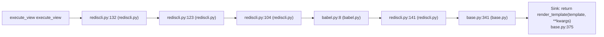

# CWE-79 · xss in rediscli.py 

**GHSA-BBDF-A52E-E23D** ｜ 规则层 P0 ｜ endpoint
**CVSS v3.1：6.1 MEDIUM** ｜ `CVSS:3.1/AV:N/AC:L/PR:N/UI:R/S:C/C:L/I:L/A:N`

## Affected Component

- Repository: `C:\myFloders\git\nexus-audit\reference_repos\flask-admin`
- File: `flask_admin/contrib/rediscli.py:183`
- Representative entry: `execute_view`
- Affected routes: **1**（同一独立根因）

- `execute_view`

## Vulnerability Mechanism

类目 `xss`（CWE-79）。根因签名：`xss:C:\myFloders\git\nexus-audit\reference_repos\flask-admin\flask_admin\contrib\rediscli.py:183:execute_view`。

- `global-config`：结论来自 `框架装配证据` 中的同一份全局配置，所有
  受影响路由共享该根因；修一处配置即消解整组告警。
- `file-level`：密钥/凭证直接写在配置文件或工具类中。
- `endpoint`：入口方法自身的确定性证据，按文件/行独立。

## Taint Flow



## PoC Harness

```python
"""execute_view 的 PoC 骨架（M45 PoC 合成器）。

规则层判定：xss = True
目标位置：rediscli.py:183
运行：pytest test_poc_execute_view.py -q
"""
import pytest


@pytest.fixture
def client():
    """离线占位：真实环境应替换成 app.test_client() 或 requests.Session。"""
    raise NotImplementedError("请在此接入被测应用的测试客户端")


ATTACKER = "attacker"
VICTIM = "victim"


def test_bola_other_account_denied(client):
    """用他人身份访问本账户资源应被拒绝 —— 放行即越权。"""
    resp = client.get("execute_view", params={"self": "1"}, headers={"Authorization": "Bearer " + ATTACKER})
    assert resp.status_code in (401, 403, 404), (
        "越权访问未被拒绝（状态码 %s）" % resp.status_code)

```

> 自检：ast.parse 通过

## Verified Patch

（本次未跑 `--fix` 或该类目没有确定性补丁器；架构/配置类缺陷按建议手工修复。）

## Quick Reproduction Command

```bash
# 1) 离线复核本仓（本根因在输出里按 flask_admin/contrib/rediscli.py:183 定位）
python cli.py scan C:\myFloders\git\nexus-audit\reference_repos\flask-admin --auto --offline

# 2) 生成 PoC + 自检补丁 + 披露包
python cli.py scan C:\myFloders\git\nexus-audit\reference_repos\flask-admin --auto --offline --emit-poc poc/ --fix --advisory-dir adv/

# 3) 只看本类目（24 类中的 xss）
python cli.py scan C:\myFloders\git\nexus-audit\reference_repos\flask-admin --categories xss --offline
```

## References

- CWE: https://cwe.mitre.org/data/definitions/79.html
- Generated by nexus-audit `scan --auto --advisory-dir`
