# CWE-73 · arbitrary_file_delete in FileController.java 

**GHSA-FECB-5821-684E** ｜ 规则层 P0 ｜ endpoint
**CVSS v3.1：8.1 HIGH** ｜ `CVSS:3.1/AV:N/AC:L/PR:L/UI:N/S:U/C:H/I:H/A:N`

## Affected Component

- Repository: `C:\myFloders\git\nexus-audit\reference_repos\kkFileView`
- File: `server/src/main/java/cn/keking/web/controller/FileController.java:240`
- Representative entry: `FileController.deleteFile`
- Affected routes: **1**（同一独立根因）

- `FileController.deleteFile`

## Vulnerability Mechanism

类目 `arbitrary_file_delete`（CWE-73）。根因签名：`arbitrary_file_delete:C:\myFloders\git\nexus-audit\reference_repos\kkFileView\server\src\main\java\cn\keking\web\controller\FileController.java:240:FileController.deleteFile`。

- `global-config`：结论来自 `框架装配证据` 中的同一份全局配置，所有
  受影响路由共享该根因；修一处配置即消解整组告警。
- `file-level`：密钥/凭证直接写在配置文件或工具类中。
- `endpoint`：入口方法自身的确定性证据，按文件/行独立。

## Taint Flow

```mermaid
flowchart LR
  N0["FileController.deleteFile /deleteFile"]
  N1["同文件辅助方法 (FileController.java)"]
  N2["WebUtils.java:431 (WebUtils.java)"]
  N3["ReturnResponse.java:41 (ReturnResponse.java)"]
  N4["ReturnResponse.java:61 (ReturnResponse.java)"]
  N5["ReturnResponse.java:49 (ReturnResponse.java)"]
  N6["removeSessionAttr() 的接口实现类方法体 (WebUtils.java)"]
  N7["failure() 的接口实现类方法体 (ReturnResponse.java)"]
  N8["isDirectory() 的接口实现类方法体 (FileController.java)"]
  N0 --> N1
  N1 --> N2
  N2 --> N3
  N3 --> N4
  N4 --> N5
  N5 --> N6
  N6 --> N7
  N7 --> N8
```



## PoC Harness

```java
// 自动生成的 PoC 骨架（M45 PoC 合成器）
// 规则层判定：arbitrary_file_delete = True
// 目标位置：FileController.java:240
package poc;

import org.junit.jupiter.api.Test;
import org.springframework.beans.factory.annotation.Autowired;
import org.springframework.boot.test.autoconfigure.web.servlet.AutoConfigureMockMvc;
import org.springframework.boot.test.context.SpringBootTest;
import org.springframework.test.web.servlet.MockMvc;
import static org.springframework.test.web.servlet.request.MockMvcRequestBuilders.*;
import static org.springframework.test.web.servlet.result.MockMvcResultMatchers.*;
import static org.springframework.test.web.servlet.setup.MockMvcBuilders.*;
import static org.hamcrest.Matchers.not;

@SpringBootTest
@AutoConfigureMockMvc
public class Filecontroller_deletefilePocTest {

    @Autowired
    private MockMvc mockMvc;

    @Test
    void otherAccountResourceDenied() throws Exception {
        mockMvc.perform(get("/deleteFile").param("id", "9999")
                .header("Authorization", "Bearer attacker-token"))
            .andExpect(status().is4xxClientError());
    }
}

```

> 自检：括号配平 + class/@Test/import 齐备

## Verified Patch

（本次未跑 `--fix` 或该类目没有确定性补丁器；架构/配置类缺陷按建议手工修复。）

## Quick Reproduction Command

```bash
# 1) 离线复核本仓（本根因在输出里按 server/src/main/java/cn/keking/web/controller/FileController.java:240 定位）
python cli.py scan C:\myFloders\git\nexus-audit\reference_repos\kkFileView --auto --offline

# 2) 生成 PoC + 自检补丁 + 披露包
python cli.py scan C:\myFloders\git\nexus-audit\reference_repos\kkFileView --auto --offline --emit-poc poc/ --fix --advisory-dir adv/

# 3) 只看本类目（24 类中的 arbitrary_file_delete）
python cli.py scan C:\myFloders\git\nexus-audit\reference_repos\kkFileView --categories arbitrary_file_delete --offline
```

## References

- CWE: https://cwe.mitre.org/data/definitions/73.html
- Generated by nexus-audit `scan --auto --advisory-dir`
