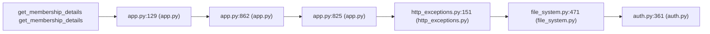

# CWE-285 · authz in app.py 

**GHSA-777E-0D72-911C** ｜ 规则层 P0 ｜ endpoint
**CVSS v3.1：8.1 HIGH** ｜ `CVSS:3.1/AV:N/AC:L/PR:L/UI:N/S:U/C:H/I:H/A:N`

## Affected Component

- Repository: `C:\myFloders\git\nexus-audit\reference_repos\litestar`
- File: `litestar/app.py:878`
- Representative entry: `get_membership_details`
- Affected routes: **1**（同一独立根因）

- `get_membership_details`

## Vulnerability Mechanism

类目 `authz`（CWE-285）。根因签名：`authz:C:\myFloders\git\nexus-audit\reference_repos\litestar\litestar\app.py:878:get_membership_details`。

- `global-config`：结论来自 `框架装配证据` 中的同一份全局配置，所有
  受影响路由共享该根因；修一处配置即消解整组告警。
- `file-level`：密钥/凭证直接写在配置文件或工具类中。
- `endpoint`：入口方法自身的确定性证据，按文件/行独立。

## Taint Flow



## PoC Harness

```python
"""get_membership_details 的 PoC 骨架（M45 PoC 合成器）。

规则层判定：authz = True
目标位置：app.py:878
运行：pytest test_poc_get_membership_details.py -q
"""
import pytest


@pytest.fixture
def client():
    """离线占位：真实环境应替换成 app.test_client() 或 requests.Session。"""
    raise NotImplementedError("请在此接入被测应用的测试客户端")


ATTACKER = "attacker"
VICTIM = "victim"


def test_bola_other_account_denied(client):
    """用他人身份访问本账户资源应被拒绝 —— 放行即越权。"""
    resp = client.get("get_membership_details", params={"group_id": "1"}, headers={"Authorization": "Bearer " + ATTACKER})
    assert resp.status_code in (401, 403, 404), (
        "越权访问未被拒绝（状态码 %s）" % resp.status_code)

```

> 自检：ast.parse 通过

## Verified Patch

（本次未跑 `--fix` 或该类目没有确定性补丁器；架构/配置类缺陷按建议手工修复。）

## Quick Reproduction Command

```bash
# 1) 离线复核本仓（本根因在输出里按 litestar/app.py:878 定位）
python cli.py scan C:\myFloders\git\nexus-audit\reference_repos\litestar --auto --offline

# 2) 生成 PoC + 自检补丁 + 披露包
python cli.py scan C:\myFloders\git\nexus-audit\reference_repos\litestar --auto --offline --emit-poc poc/ --fix --advisory-dir adv/

# 3) 只看本类目（24 类中的 authz）
python cli.py scan C:\myFloders\git\nexus-audit\reference_repos\litestar --categories authz --offline
```

## References

- CWE: https://cwe.mitre.org/data/definitions/285.html
- Generated by nexus-audit `scan --auto --advisory-dir`
