# CWE-285 · authz in DeliveryController.java

**GHSA-CE47-59B1-DACE** ｜ 规则层 P0 ｜ endpoint
**CVSS v3.1：8.1 HIGH** ｜ `CVSS:3.1/AV:N/AC:L/PR:L/UI:N/S:U/C:H/I:H/A:N`

## Affected Component

- Repository: `C:\myFloders\git\nexus-audit\reference_repos\mall4j`
- File: `yami-shop-api/src/main/java/com/yami/shop/api/controller/DeliveryController.java:48`
- Representative entry: `DeliveryController.checkDelivery`
- Affected routes: **1**（同一独立根因）

- `DeliveryController.checkDelivery`

## Vulnerability Mechanism

类目 `authz`（CWE-285）。根因签名：`authz:C:\myFloders\git\nexus-audit\reference_repos\mall4j\yami-shop-api\src\main\java\com\yami\shop\api\controller\DeliveryController.java:48:DeliveryController.checkDelivery`。

- `global-config`：结论来自 `框架装配证据` 中的同一份全局配置，所有
  受影响路由共享该根因；修一处配置即消解整组告警。
- `file-level`：密钥/凭证直接写在配置文件或工具类中。
- `endpoint`：入口方法自身的确定性证据，按文件/行独立。

## Taint Flow

```mermaid
flowchart LR
  N0["DeliveryController.checkDelivery /delivery/check"]
  N1["NoticeController.java:65 (NoticeController.java)"]
  N2["ServerResponseEntity.java:112 (ServerResponseEntity.java)"]
  N3["ServerResponseEntity.java:79 (ServerResponseEntity.java)"]
  N4["OrderServiceImpl.java:61 (OrderServiceImpl.java)"]
  N5["Json.java:79 (Json.java)"]
  N6["ServerResponseEntity.java:112 (ServerResponseEntity.java)"]
  N7["getOrderByOrderNumber() 的接口实现类方法体 (OrderServiceImpl.java)"]
  N8["getById() 的接口实现类方法体 (NoticeController.java)"]
  N9["get() 的接口实现类方法体 (CaptchaCacheServiceRedisImpl.java)"]
  N0 --> N1
  N1 --> N2
  N2 --> N3
  N3 --> N4
  N4 --> N5
  N5 --> N6
  N6 --> N7
  N7 --> N8
  N8 --> N9
  SINK["Sink: Order order = orderService.getOrderByOrderNumber(orderNumber<br/>DeliveryController.java:53"]
  N0 --> SINK
```



## PoC Harness

```java
// 自动生成的 PoC 骨架（M45 PoC 合成器）
// 规则层判定：authz = True
// 目标位置：DeliveryController.java:48
package poc;

import org.junit.jupiter.api.Test;
import org.springframework.beans.factory.annotation.Autowired;
import org.springframework.boot.test.autoconfigure.web.servlet.AutoConfigureMockMvc;
import org.springframework.boot.test.context.SpringBootTest;
import org.springframework.test.web.servlet.MockMvc;
import static org.springframework.test.web.servlet.request.MockMvcRequestBuilders.*;
import static org.springframework.test.web.servlet.result.MockMvcResultMatchers.*;
import static org.springframework.test.web.servlet.setup.MockMvcBuilders.*;
import static org.hamcrest.Matchers.not;

@SpringBootTest
@AutoConfigureMockMvc
public class Deliverycontroller_checkdeliveryPocTest {

    @Autowired
    private MockMvc mockMvc;

    @Test
    void otherAccountResourceDenied() throws Exception {
        mockMvc.perform(get("/delivery/check").param("id", "9999")
                .header("Authorization", "Bearer attacker-token"))
            .andExpect(status().is4xxClientError());
    }
}

```

> 自检：括号配平 + class/@Test/import 齐备

## Verified Patch

（本次未跑 `--fix` 或该类目没有确定性补丁器；架构/配置类缺陷按建议手工修复。）

## References

- CWE: https://cwe.mitre.org/data/definitions/285.html
- Generated by nexus-audit `scan --auto --advisory-dir`
