# CWE-330 · weakrand in NewBeeAdminUploadAPI.java

**GHSA-7A0A-A259-86AE** ｜ 规则层 P0 ｜ endpoint
**CVSS v3.1：5.9 MEDIUM** ｜ `CVSS:3.1/AV:N/AC:H/PR:N/UI:N/S:U/C:H/I:N/A:N`

## Affected Component

- Repository: `C:\myFloders\git\nexus-audit\reference_repos\newbee-mall-api-master`
- File: `src/main/java/ltd/newbee/mall/api/admin/NewBeeAdminUploadAPI.java:49`
- Representative entry: `NewBeeAdminUploadAPI.upload`
- Affected routes: **1**（同一独立根因）

- `NewBeeAdminUploadAPI.upload`

## Vulnerability Mechanism

类目 `weakrand`（CWE-330）。根因签名：`weakrand:C:\myFloders\git\nexus-audit\reference_repos\newbee-mall-api-master\src\main\java\ltd\newbee\mall\api\admin\NewBeeAdminUploadAPI.java:49:NewBeeAdminUploadAPI.upload`。

- `global-config`：结论来自 `框架装配证据` 中的同一份全局配置，所有
  受影响路由共享该根因；修一处配置即消解整组告警。
- `file-level`：密钥/凭证直接写在配置文件或工具类中。
- `endpoint`：入口方法自身的确定性证据，按文件/行独立。

## Taint Flow

```mermaid
flowchart LR
  N0["NewBeeAdminUploadAPI.upload /manage-api/v1/upload/file"]
  N1["NewBeeAdminCarouselAPI.java:109 (NewBeeAdminCarouselAPI.java)"]
  N2["NewBeeMallCarouselServiceImpl.java:67 (NewBeeMallCarouselServiceImpl.java)"]
  N3["CarouselMapper.xml (CarouselMapper.xml)"]
  N4["ResultGenerator.java:41 (ResultGenerator.java)"]
  N5["ResultGenerator.java:19 (ResultGenerator.java)"]
  N6["ResultGenerator.java:41 (ResultGenerator.java)"]
  N7["ResultGenerator.java:19 (ResultGenerator.java)"]
  N8["info() 的接口实现类方法体 (NewBeeAdminCarouselAPI.java)"]
  N9["setData() 的接口实现类方法体 (Result.java)"]
  N10["getHost() 的接口实现类方法体 (NewBeeMallUtils.java)"]
  N0 --> N1
  N1 --> N2
  N2 --> N3
  N3 --> N4
  N4 --> N5
  N5 --> N6
  N6 --> N7
  N7 --> N8
  N8 --> N9
  N9 --> N10
```



## PoC Harness

```java
// 自动生成的 PoC 骨架（M45 PoC 合成器）
// 规则层判定：weakrand = True
// 目标位置：NewBeeAdminUploadAPI.java:49
package poc;

import org.junit.jupiter.api.Test;
import org.springframework.beans.factory.annotation.Autowired;
import org.springframework.boot.test.autoconfigure.web.servlet.AutoConfigureMockMvc;
import org.springframework.boot.test.context.SpringBootTest;
import org.springframework.test.web.servlet.MockMvc;
import static org.springframework.test.web.servlet.request.MockMvcRequestBuilders.*;
import static org.springframework.test.web.servlet.result.MockMvcResultMatchers.*;
import static org.springframework.test.web.servlet.setup.MockMvcBuilders.*;
import static org.hamcrest.Matchers.not;

@SpringBootTest
@AutoConfigureMockMvc
public class Newbeeadminuploadapi_uploadPocTest {

    @Autowired
    private MockMvc mockMvc;

    @Test
    void otherAccountResourceDenied() throws Exception {
        mockMvc.perform(get("/manage-api/v1/upload/file").param("id", "9999")
                .header("Authorization", "Bearer attacker-token"))
            .andExpect(status().is4xxClientError());
    }
}

```

> 自检：括号配平 + class/@Test/import 齐备

## Verified Patch

（本次未跑 `--fix` 或该类目没有确定性补丁器；架构/配置类缺陷按建议手工修复。）

## References

- CWE: https://cwe.mitre.org/data/definitions/330.html
- Generated by nexus-audit `scan --auto --advisory-dir`
