# CWE-328 · hash in NewBeeMallPersonalAPI.java 

**GHSA-C58F-566D-2506** ｜ 规则层 P0 ｜ endpoint
**CVSS v3.1：5.9 MEDIUM** ｜ `CVSS:3.1/AV:N/AC:H/PR:N/UI:N/S:U/C:H/I:N/A:N`

## Affected Component

- Repository: `C:\myFloders\git\nexus-audit\reference_repos\newbee-mall-api-master`
- File: `src/main/java/ltd/newbee/mall/api/mall/NewBeeMallPersonalAPI.java:95`
- Representative entry: `NewBeeMallPersonalAPI.updateInfo`
- Affected routes: **1**（同一独立根因）

- `NewBeeMallPersonalAPI.updateInfo`

## Vulnerability Mechanism

类目 `hash`（CWE-328）。根因签名：`hash:C:\myFloders\git\nexus-audit\reference_repos\newbee-mall-api-master\src\main\java\ltd\newbee\mall\api\mall\NewBeeMallPersonalAPI.java:95:NewBeeMallPersonalAPI.updateInfo`。

- `global-config`：结论来自 `框架装配证据` 中的同一份全局配置，所有
  受影响路由共享该根因；修一处配置即消解整组告警。
- `file-level`：密钥/凭证直接写在配置文件或工具类中。
- `endpoint`：入口方法自身的确定性证据，按文件/行独立。

## Taint Flow

```mermaid
flowchart LR
  N0["NewBeeMallPersonalAPI.updateInfo /api/v1/user/info"]
  N1["NewBeeMallUserServiceImpl.java:105 (NewBeeMallUserServiceImpl.java)"]
  N2["MD5Util.java:30 (MD5Util.java)"]
  N3["MallUserMapper.xml (MallUserMapper.xml)"]
  N4["MallUserMapper.xml (MallUserMapper.xml)"]
  N5["NewBeeMallException.java:25 (NewBeeMallException.java)"]
  N6["ResultGenerator.java:41 (ResultGenerator.java)"]
  N7["ResultGenerator.java:19 (ResultGenerator.java)"]
  N8["updateUserInfo() 的接口实现类方法体 (NewBeeMallUserServiceImpl.java)"]
  N10["跨路由串接证据 (NewBeeMallPersonalAPI.java)"]
  N0 --> N1
  N1 --> N2
  N2 --> N3
  N3 --> N4
  N4 --> N5
  N5 --> N6
  N6 --> N7
  N7 --> N8
  N8 --> N10
```



## PoC Harness

```java
// 自动生成的 PoC 骨架（M45 PoC 合成器）
// 规则层判定：hash = True
// 目标位置：NewBeeMallPersonalAPI.java:95
package poc;

import org.junit.jupiter.api.Test;
import org.springframework.beans.factory.annotation.Autowired;
import org.springframework.boot.test.autoconfigure.web.servlet.AutoConfigureMockMvc;
import org.springframework.boot.test.context.SpringBootTest;
import org.springframework.test.web.servlet.MockMvc;
import static org.springframework.test.web.servlet.request.MockMvcRequestBuilders.*;
import static org.springframework.test.web.servlet.result.MockMvcResultMatchers.*;
import static org.springframework.test.web.servlet.setup.MockMvcBuilders.*;
import static org.hamcrest.Matchers.not;

@SpringBootTest
@AutoConfigureMockMvc
public class Newbeemallpersonalapi_updateinfoPocTest {

    @Autowired
    private MockMvc mockMvc;

    @Test
    void otherAccountResourceDenied() throws Exception {
        mockMvc.perform(get("/api/v1/user/info").param("id", "9999")
                .header("Authorization", "Bearer attacker-token"))
            .andExpect(status().is4xxClientError());
    }
}

```

> 自检：括号配平 + class/@Test/import 齐备

## Verified Patch

（本次未跑 `--fix` 或该类目没有确定性补丁器；架构/配置类缺陷按建议手工修复。）

## Quick Reproduction Command

```bash
# 1) 离线复核本仓（本根因在输出里按 src/main/java/ltd/newbee/mall/api/mall/NewBeeMallPersonalAPI.java:95 定位）
python cli.py scan C:\myFloders\git\nexus-audit\reference_repos\newbee-mall-api-master --auto --offline

# 2) 生成 PoC + 自检补丁 + 披露包
python cli.py scan C:\myFloders\git\nexus-audit\reference_repos\newbee-mall-api-master --auto --offline --emit-poc poc/ --fix --advisory-dir adv/

# 3) 只看本类目（24 类中的 hash）
python cli.py scan C:\myFloders\git\nexus-audit\reference_repos\newbee-mall-api-master --categories hash --offline
```

## References

- CWE: https://cwe.mitre.org/data/definitions/328.html
- Generated by nexus-audit `scan --auto --advisory-dir`
