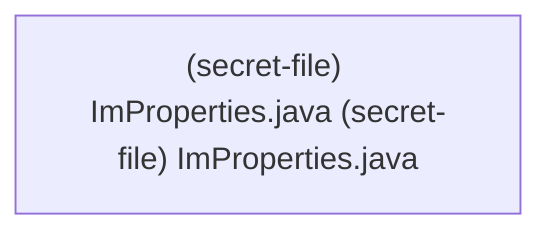

# CWE-798 · hardcoded_secret in ImProperties.java 

**GHSA-4B65-511D-96D4** ｜ 规则层 P0 ｜ file-level
**CVSS v3.1：9.8 CRITICAL** ｜ `CVSS:3.1/AV:N/AC:L/PR:N/UI:N/S:U/C:H/I:H/A:H`

## Affected Component

- Repository: `C:\myFloders\git\nexus-audit\reference_repos\ruoyi-vue-pro`
- File: `yudao-module-im/src/main/java/cn/iocoder/yudao/module/im/framework/config/ImProperties.java:1`
- Representative entry: `[secret-file] ImProperties.java`
- Affected routes: **1**（同一独立根因）

- `[secret-file] ImProperties.java`

## Vulnerability Mechanism

类目 `hardcoded_secret`（CWE-798）。根因签名：`hardcoded_secret:file:C:\myFloders\git\nexus-audit\reference_repos\ruoyi-vue-pro\yudao-module-im\src\main\java\cn\iocoder\yudao\module\im\framework\config\ImProperties.java`。

- `global-config`：结论来自 `框架装配证据` 中的同一份全局配置，所有
  受影响路由共享该根因；修一处配置即消解整组告警。
- `file-level`：密钥/凭证直接写在配置文件或工具类中。
- `endpoint`：入口方法自身的确定性证据，按文件/行独立。

## Taint Flow



## PoC Harness

```python
"""[secret-file] ImProperties.java 的 PoC 骨架（M45 PoC 合成器）。

规则层判定：hardcoded_secret = True
目标位置：ImProperties.java:1
运行：pytest test_poc_secret_file_ImProperties_java.py -q
"""
import pytest


@pytest.fixture
def client():
    """离线占位：真实环境应替换成 app.test_client() 或 requests.Session。"""
    raise NotImplementedError("请在此接入被测应用的测试客户端")


ATTACKER = "attacker"
VICTIM = "victim"


def test_forged_admin_token_with_hardcoded_secret(client):
    """用代码里的硬编码密钥离线签发管理员 JWT，验证其可被用于伪造身份。"""
    import jwt
    forged = jwt.encode({"sub": "admin", "role": "admin"},
                        'secret-poc-key-min-32-chars-required-here', algorithm="HS256")
    resp = client.get("[secret-file] ImProperties.java", params={"id": "1"}, headers={"Authorization": "Bearer " + forged})
    assert resp.status_code != 200, "硬编码密钥可伪造管理员 Token"

```

> 自检：ast.parse 通过

## Verified Patch

（本次未跑 `--fix` 或该类目没有确定性补丁器；架构/配置类缺陷按建议手工修复。）

## Quick Reproduction Command

```bash
# 1) 离线复核本仓（本根因在输出里按 yudao-module-im/src/main/java/cn/iocoder/yudao/module/im/framework/config/ImProperties.java:1 定位）
python cli.py scan C:\myFloders\git\nexus-audit\reference_repos\ruoyi-vue-pro --auto --offline

# 2) 生成 PoC + 自检补丁 + 披露包
python cli.py scan C:\myFloders\git\nexus-audit\reference_repos\ruoyi-vue-pro --auto --offline --emit-poc poc/ --fix --advisory-dir adv/

# 3) 只看本类目（24 类中的 hardcoded_secret）
python cli.py scan C:\myFloders\git\nexus-audit\reference_repos\ruoyi-vue-pro --categories hardcoded_secret --offline
```

## References

- CWE: https://cwe.mitre.org/data/definitions/798.html
- Generated by nexus-audit `scan --auto --advisory-dir`
