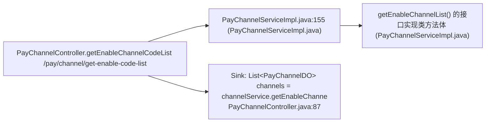

# CWE-285 · authz in PayChannelController.java 

**GHSA-854A-FB9C-0767** ｜ 规则层 P0 ｜ endpoint
**CVSS v3.1：8.1 HIGH** ｜ `CVSS:3.1/AV:N/AC:L/PR:L/UI:N/S:U/C:H/I:H/A:N`

## Affected Component

- Repository: `C:\myFloders\git\nexus-audit\reference_repos\ruoyi-vue-pro`
- File: `yudao-module-pay/src/main/java/cn/iocoder/yudao/module/pay/controller/admin/channel/PayChannelController.java:83`
- Representative entry: `PayChannelController.getEnableChannelCodeList`
- Affected routes: **1**（同一独立根因）

- `PayChannelController.getEnableChannelCodeList`

## Vulnerability Mechanism

类目 `authz`（CWE-285）。根因签名：`authz:C:\myFloders\git\nexus-audit\reference_repos\ruoyi-vue-pro\yudao-module-pay\src\main\java\cn\iocoder\yudao\module\pay\controller\admin\channel\PayChannelController.java:83:PayChannelController.getEnableChannelCodeList`。

- `global-config`：结论来自 `框架装配证据` 中的同一份全局配置，所有
  受影响路由共享该根因；修一处配置即消解整组告警。
- `file-level`：密钥/凭证直接写在配置文件或工具类中。
- `endpoint`：入口方法自身的确定性证据，按文件/行独立。

## Taint Flow



## PoC Harness

```java
// 自动生成的 PoC 骨架（M45 PoC 合成器）
// 规则层判定：authz = True
// 目标位置：PayChannelController.java:83
package poc;

import org.junit.jupiter.api.Test;
import org.springframework.beans.factory.annotation.Autowired;
import org.springframework.boot.test.autoconfigure.web.servlet.AutoConfigureMockMvc;
import org.springframework.boot.test.context.SpringBootTest;
import org.springframework.test.web.servlet.MockMvc;
import static org.springframework.test.web.servlet.request.MockMvcRequestBuilders.*;
import static org.springframework.test.web.servlet.result.MockMvcResultMatchers.*;
import static org.springframework.test.web.servlet.setup.MockMvcBuilders.*;
import static org.hamcrest.Matchers.not;

@SpringBootTest
@AutoConfigureMockMvc
public class Paychannelcontroller_getenablechannelcodelistPocTest {

    @Autowired
    private MockMvc mockMvc;

    @Test
    void otherAccountResourceDenied() throws Exception {
        mockMvc.perform(get("/pay/channel/get-enable-code-list").param("id", "9999")
                .header("Authorization", "Bearer attacker-token"))
            .andExpect(status().is4xxClientError());
    }
}

```

> 自检：括号配平 + class/@Test/import 齐备

## Verified Patch

（本次未跑 `--fix` 或该类目没有确定性补丁器；架构/配置类缺陷按建议手工修复。）

## Quick Reproduction Command

```bash
# 1) 离线复核本仓（本根因在输出里按 yudao-module-pay/src/main/java/cn/iocoder/yudao/module/pay/controller/admin/channel/PayChannelController.java:83 定位）
python cli.py scan C:\myFloders\git\nexus-audit\reference_repos\ruoyi-vue-pro --auto --offline

# 2) 生成 PoC + 自检补丁 + 披露包
python cli.py scan C:\myFloders\git\nexus-audit\reference_repos\ruoyi-vue-pro --auto --offline --emit-poc poc/ --fix --advisory-dir adv/

# 3) 只看本类目（24 类中的 authz）
python cli.py scan C:\myFloders\git\nexus-audit\reference_repos\ruoyi-vue-pro --categories authz --offline
```

## References

- CWE: https://cwe.mitre.org/data/definitions/285.html
- Generated by nexus-audit `scan --auto --advisory-dir`
