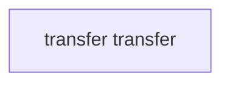

# CWE-190 · arithmetic in ERC20.sol 

**GHSA-5BD2-2E2D-B948** ｜ 规则层 P0 ｜ endpoint
**CVSS v3.1：7.5 HIGH** ｜ `CVSS:3.1/AV:N/AC:L/PR:N/UI:N/S:U/C:N/I:N/A:H`

## Affected Component

- Repository: `C:\myFloders\git\nexus-audit\reference_repos\solmate\src`
- File: `tokens/ERC20.sol:76`
- Representative entry: `transfer`
- Affected routes: **1**（同一独立根因）

- `transfer`

## Vulnerability Mechanism

类目 `arithmetic`（CWE-190）。根因签名：`arithmetic:C:\myFloders\git\nexus-audit\reference_repos\solmate\src\tokens\ERC20.sol:76:transfer`。

- `global-config`：结论来自 `框架装配证据` 中的同一份全局配置，所有
  受影响路由共享该根因；修一处配置即消解整组告警。
- `file-level`：密钥/凭证直接写在配置文件或工具类中。
- `endpoint`：入口方法自身的确定性证据，按文件/行独立。

## Taint Flow



## PoC Harness

```solidity
// SPDX-License-Identifier: MIT
// 自动生成的 PoC 骨架（M45 PoC 合成器）—— 目标：transfer
// 规则层判定：arithmetic = True
// 目标位置：ERC20.sol:76
pragma solidity ^0.8.0;

import "forge-std/Test.sol";

contract Poctransfer is Test {
    function testExploit() public {
        // 0.4.x~0.7.x 编译器不检查溢出（SWC-101）：
        // 极值输入 type(uint256).max 让算术回卷 —— sum += x 绕回成 0
        Victim victim = new Victim();

        // 第一次入账把累计值推到上界附近，第二次极值入账触发回卷
        // （骨架按 Victim 的入账入口 deposit(uint256) 形态生成；
        //  实际接入时按目标函数签名替换调用形态）
        vm.prank(address(0xA11CE));
        victim.deposit(type(uint256).max);

        vm.prank(address(0xBAD));
        victim.deposit(1);

        // 断言：上溢回卷 —— 累计值不增反减（修复后 require 会 revert）
        assertTrue(victim.totalSupply() < type(uint256).max,
                   "expected uint256 wraparound");
    }
}

```

> 自检：括号配平 + contract/test/pragma 齐备

## Verified Patch

（本次未跑 `--fix` 或该类目没有确定性补丁器；架构/配置类缺陷按建议手工修复。）

## Quick Reproduction Command

```bash
# 1) 离线复核本仓（本根因在输出里按 tokens/ERC20.sol:76 定位）
python cli.py scan C:\myFloders\git\nexus-audit\reference_repos\solmate\src --auto --offline

# 2) 生成 PoC + 自检补丁 + 披露包
python cli.py scan C:\myFloders\git\nexus-audit\reference_repos\solmate\src --auto --offline --emit-poc poc/ --fix --advisory-dir adv/

# 3) 只看本类目（24 类中的 arithmetic）
python cli.py scan C:\myFloders\git\nexus-audit\reference_repos\solmate\src --categories arithmetic --offline
```

## References

- CWE: https://cwe.mitre.org/data/definitions/190.html
- Generated by nexus-audit `scan --auto --advisory-dir`
