# CWE-89 · sqli in GenController.java **[Auto-Fix Verified]**

**GHSA-8224-3C28-B89E** ｜ 规则层 P0 ｜ endpoint
**CVSS v3.1：9.8 CRITICAL** ｜ `CVSS:3.1/AV:N/AC:L/PR:N/UI:N/S:U/C:H/I:H/A:H`

## Affected Component

- Repository: `reference_repos\RuoYi-master`
- File: `ruoyi-generator/src/main/java/com/ruoyi/generator/controller/GenController.java:195`
- Representative entry: `GenController.create`
- Affected routes: **1**（同一独立根因）

- `GenController.create`

## Vulnerability Mechanism

类目 `sqli`（CWE-89）。根因签名：`sqli:C:\myFloders\git\nexus-audit\reference_repos\RuoYi-master\ruoyi-generator\src\main\java\com\ruoyi\generator\controller\GenController.java:195:GenController.create`。

- `global-config`：结论来自 `框架装配证据` 中的同一份全局配置，所有
  受影响路由共享该根因；修一处配置即消解整组告警。
- `file-level`：密钥/凭证直接写在配置文件或工具类中。
- `endpoint`：入口方法自身的确定性证据，按文件/行独立。

## Taint Flow

```mermaid
flowchart LR
  N0["GenController.create /tool/gen/createTable"]
  N1["SqlUtil.java:55 (SqlUtil.java)"]
  N2["StringUtils.java:590 (StringUtils.java)"]
  N3["PermissionService.java:238 (PermissionService.java)"]
  N4["BaseController.java:153 (BaseController.java)"]
  N5["ShiroUtils.java:18 (ShiroUtils.java)"]
  N6["GenTableMapper.xml (GenTableMapper.xml)"]
  N7["BaseController.java:153 (BaseController.java)"]
  N8["跨文件证据：被调方法的接口声明（方法无方法体，实现由框架/子类提供） (GenController.java)"]
  N9["filterKeyword() 的接口实现类方法体 (SqlUtil.java)"]
  N10["createTable() 的接口实现类方法体 (GenTableServiceImpl.java)"]
  N11["add() 的接口实现类方法体 (SysJobController.java)"]
  N13["跨路由串接证据 (GenController.java)"]
  N0 --> N1
  N1 --> N2
  N2 --> N3
  N3 --> N4
  N4 --> N5
  N5 --> N6
  N6 --> N7
  N7 --> N8
  N8 --> N9
  N9 --> N10
  N10 --> N11
  N11 --> N13
  SINK["Sink: &lt;update id='createTable'&gt;$&lbrace;sql&rbrace;&lt;/update&gt;<br/>GenTableMapper.xml"]
  N6 --> SINK
```



## PoC Harness

```java
// 自动生成的 PoC 骨架（M45 PoC 合成器）
// 规则层判定：sqli = True
// 目标位置：GenController.java:195
package poc;

import org.junit.jupiter.api.Test;
import org.springframework.beans.factory.annotation.Autowired;
import org.springframework.boot.test.autoconfigure.web.servlet.AutoConfigureMockMvc;
import org.springframework.boot.test.context.SpringBootTest;
import org.springframework.test.web.servlet.MockMvc;
import static org.springframework.test.web.servlet.request.MockMvcRequestBuilders.*;
import static org.springframework.test.web.servlet.result.MockMvcResultMatchers.*;
import static org.springframework.test.web.servlet.setup.MockMvcBuilders.*;
import static org.hamcrest.Matchers.not;

@SpringBootTest
@AutoConfigureMockMvc
public class Gencontroller_createPocTest {

    @Autowired
    private MockMvc mockMvc;

    @Test
    void sqlInjectionPayloadRejected() throws Exception {
        mockMvc.perform(get("/tool/gen/createTable").param("id", "' OR '1'='1' --"))
            .andExpect(status().is4xxClientError());
    }
}

```

> 自检：括号配平 + class/@Test/import 齐备

## Verified Patch

```diff
--- a/GenTableMapper.xml
+++ b/GenTableMapper.xml
@@ -166,7 +166,7 @@
     </insert>
     
     <update id="createTable">
-        ${sql}
+        #{sql}
     </update>
     
     <update id="updateGenTable" parameterType="GenTable">
```

## Quick Reproduction Command

```bash
# 1) 离线复核本仓（本根因在输出里按 ruoyi-generator/src/main/java/com/ruoyi/generator/controller/GenController.java:195 定位）
python cli.py scan reference_repos\RuoYi-master --auto --offline

# 2) 生成 PoC + 自检补丁 + 披露包
python cli.py scan reference_repos\RuoYi-master --auto --offline --emit-poc poc/ --fix --advisory-dir adv/

# 3) 只看本类目（24 类中的 sqli）
python cli.py scan reference_repos\RuoYi-master --categories sqli --offline
```

## References

- CWE: https://cwe.mitre.org/data/definitions/89.html
- Generated by nexus-audit `scan --auto --advisory-dir`
