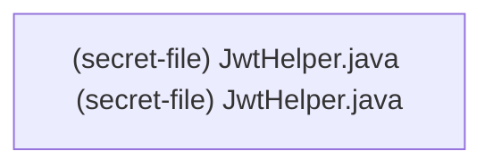

# CWE-798 · hardcoded_secret in JwtHelper.java **[Auto-Fix Verified]**

**GHSA-103D-C9DB-C856** ｜ 规则层 P0 ｜ file-level
**CVSS v3.1：9.8 CRITICAL** ｜ `CVSS:3.1/AV:N/AC:L/PR:N/UI:N/S:U/C:H/I:H/A:H`

## Affected Component

- Repository: https://github.com/linlinjava/litemall
- File: `litemall-wx-api/src/main/java/org/linlinjava/litemall/wx/util/JwtHelper.java:1`
- Representative entry: `[secret-file] JwtHelper.java`
- Affected routes: **1**（同一独立根因）

- `[secret-file] JwtHelper.java`

## Vulnerability Mechanism

类目 `hardcoded_secret`（CWE-798）。根因签名：`hardcoded_secret:file:C:\myFloders\git\nexus-audit\reference_repos\litemall-master\litemall-wx-api\src\main\java\org\linlinjava\litemall\wx\util\JwtHelper.java`。

- `global-config`：结论来自 `框架装配证据` 中的同一份全局配置，所有
  受影响路由共享该根因；修一处配置即消解整组告警。
- `file-level`：密钥/凭证直接写在配置文件或工具类中。
- `endpoint`：入口方法自身的确定性证据，按文件/行独立。

## Taint Flow



## PoC Harness

```java
// 自动生成的 PoC 骨架（M45 PoC 合成器）
// 规则层判定：hardcoded_secret = True
// 目标位置：JwtHelper.java:1
package poc;

import org.junit.jupiter.api.Test;
import org.springframework.beans.factory.annotation.Autowired;
import org.springframework.boot.test.autoconfigure.web.servlet.AutoConfigureMockMvc;
import org.springframework.boot.test.context.SpringBootTest;
import org.springframework.test.web.servlet.MockMvc;
import static org.springframework.test.web.servlet.request.MockMvcRequestBuilders.*;
import static org.springframework.test.web.servlet.result.MockMvcResultMatchers.*;
import static org.springframework.test.web.servlet.setup.MockMvcBuilders.*;
import static org.hamcrest.Matchers.not;

@SpringBootTest
@AutoConfigureMockMvc
public class Secret_file_jwthelper_javaPocTest {

    @Autowired
    private MockMvc mockMvc;

    @Test
    void forgedAdminTokenWithHardcodedSecret() throws Exception {
        String forged = io.jsonwebtoken.Jwts.builder()
            .setSubject("admin").claim("role", "admin")
            .signWith(io.jsonwebtoken.SignatureAlgorithm.HS256, "X-Litemall-Token")
            .compact();
        mockMvc.perform(get("/[secret-file] JwtHelper.java")
                .header("Authorization", "Bearer " + forged))
            .andExpect(status().is4xxClientError());
    }
}

```

> 自检：括号配平 + class/@Test/import 齐备

## Verified Patch

```diff
--- a/JwtHelper.java
+++ b/JwtHelper.java
@@ -16,7 +16,7 @@
 
 public class JwtHelper {
 	// 秘钥
-	static final String SECRET = "X-Litemall-Token";
+	static final String SECRET = System.getenv("SECRET");
 	// 签名是有谁生成
 	static final String ISSUSER = "LITEMALL";
 	// 签名的主题
```

## Quick Reproduction Command

```bash
# 1) 离线复核本仓（本根因在输出里按 litemall-wx-api/src/main/java/org/linlinjava/litemall/wx/util/JwtHelper.java:1 定位）
python cli.py scan reference_repos\litemall-master --auto --offline

# 2) 生成 PoC + 自检补丁 + 披露包
python cli.py scan reference_repos\litemall-master --auto --offline --emit-poc poc/ --fix --advisory-dir adv/

# 3) 只看本类目（24 类中的 hardcoded_secret）
python cli.py scan reference_repos\litemall-master --categories hardcoded_secret --offline
```

## References

- CWE: https://cwe.mitre.org/data/definitions/798.html
- Generated by nexus-audit `scan --auto --advisory-dir`
