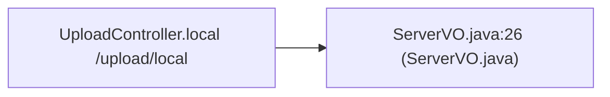

# CWE-434 · unrestricted_upload in UploadController.java **[Auto-Fix Verified]**

**GHSA-4A44-E61B-2FB1** ｜ 规则层 P0 ｜ endpoint
**CVSS v3.1：8.1 HIGH** ｜ `CVSS:3.1/AV:N/AC:L/PR:L/UI:N/S:U/C:H/I:H/A:N`

## Affected Component

- Repository: `reference_repos\spring-boot-demo`
- File: `demo-upload/src/main/java/com/xkcoding/upload/controller/UploadController.java:49`
- Representative entry: `UploadController.local`
- Affected routes: **1**（同一独立根因）

- `UploadController.local`

## Vulnerability Mechanism

类目 `unrestricted_upload`（CWE-434）。根因签名：`unrestricted_upload:C:\myFloders\git\nexus-audit\reference_repos\spring-boot-demo\demo-upload\src\main\java\com\xkcoding\upload\controller\UploadController.java:49:UploadController.local`。

- `global-config`：结论来自 `框架装配证据` 中的同一份全局配置，所有
  受影响路由共享该根因；修一处配置即消解整组告警。
- `file-level`：密钥/凭证直接写在配置文件或工具类中。
- `endpoint`：入口方法自身的确定性证据，按文件/行独立。

## Taint Flow



## PoC Harness

```java
// 自动生成的 PoC 骨架（M45 PoC 合成器）
// 规则层判定：unrestricted_upload = True
// 目标位置：UploadController.java:49
package poc;

import org.junit.jupiter.api.Test;
import org.springframework.beans.factory.annotation.Autowired;
import org.springframework.boot.test.autoconfigure.web.servlet.AutoConfigureMockMvc;
import org.springframework.boot.test.context.SpringBootTest;
import org.springframework.test.web.servlet.MockMvc;
import static org.springframework.test.web.servlet.request.MockMvcRequestBuilders.*;
import static org.springframework.test.web.servlet.result.MockMvcResultMatchers.*;
import static org.springframework.test.web.servlet.setup.MockMvcBuilders.*;
import static org.hamcrest.Matchers.not;

@SpringBootTest
@AutoConfigureMockMvc
public class Uploadcontroller_localPocTest {

    @Autowired
    private MockMvc mockMvc;

    @Test
    void otherAccountResourceDenied() throws Exception {
        mockMvc.perform(get("/upload/local").param("id", "9999")
                .header("Authorization", "Bearer attacker-token"))
            .andExpect(status().is4xxClientError());
    }
}

```

> 自检：括号配平 + class/@Test/import 齐备

## Verified Patch

```diff
--- a/UploadController.java
+++ b/UploadController.java
@@ -52,6 +52,9 @@
             return Dict.create().set("code", 400).set("message", "文件内容为空");
         }
         String fileName = file.getOriginalFilename();
+        java.util.Set<String> ALLOWED_EXT = java.util.Set.of("jpg", "jpeg", "png", "gif", "pdf");
+        String _ext = fileName.substring(fileName.lastIndexOf('.') + 1).toLowerCase();
+        if (!ALLOWED_EXT.contains(_ext)) { throw new IllegalArgumentException("unsupported file type"); }
         String rawFileName = StrUtil.subBefore(fileName, ".", true);
         String fileType = StrUtil.subAfter(fileName, ".", true);
         String localFilePath = StrUtil.appendIfMissing(fileTempPath, "/") + rawFileName + "-" + DateUtil.current(false) + "." + fileType;
```

## Quick Reproduction Command

```bash
# 1) 离线复核本仓（本根因在输出里按 demo-upload/src/main/java/com/xkcoding/upload/controller/UploadController.java:49 定位）
python cli.py scan reference_repos\spring-boot-demo --auto --offline

# 2) 生成 PoC + 自检补丁 + 披露包
python cli.py scan reference_repos\spring-boot-demo --auto --offline --emit-poc poc/ --fix --advisory-dir adv/

# 3) 只看本类目（24 类中的 unrestricted_upload）
python cli.py scan reference_repos\spring-boot-demo --categories unrestricted_upload --offline
```

## References

- CWE: https://cwe.mitre.org/data/definitions/434.html
- Generated by nexus-audit `scan --auto --advisory-dir`
